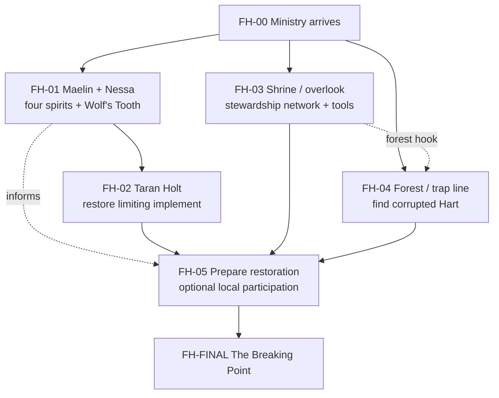

# Obscure Affairs

## The Gloaming Codex

*Volume I — Homebrewery V3 working compilation*

{{note
**Editorial status.** Source-preserving manuscript compiled from the Obscure Affairs adventure repository on 4 November 2026. Includes GM spoilers. Adventures and mechanics remain in different stages of development. Images are omitted. Page layout is preliminary.
}}

## Contents

Breach Below Bergum — adventure, four pregenerated characters, and bestiary.

Forest's Hart — adventure, locations, and compendium.

Anima Rubra — working adventure design and characters.

Design archive — open questions and playtesting.

\page

# Breach Below Bergum

\page

## index

A Pathfinder Second Edition adventure

# Breach Below Bergum

<figure class="hero-art">
  
</figure>

Twenty years after a rich silver strike transformed a riverside stop into the boomtown of Bergum, the vein is failing and the mining guild is packing up. One final cleanup operation has breached an ancient stone shrine. Apparitions now drift through town, and an exhausted sheriff has called for help.

You are the nearest detectives of the Ministry of Obscure Affairs—plus two locals with a personal stake in the mine. Descend through the breach, discover what was disturbed, and quiet it before Bergum’s last days become its darkest.

<ul class="adventure-meta">
  <li><strong>System</strong> Pathfinder Second Edition</li>
  <li><strong>Level</strong> 5</li>
  <li><strong>Players</strong> Four pregenerated characters</li>
  <li><strong>Length</strong> One-shot or short adventure</li>
</ul>

## Choose an investigator

The team combines Ministry expertise with Bergum locals who know the mine—and each other’s reputations.

  <article class="character-card"><h3><a href="{{ '/adventures/breach-below-bergum/characters/deputy-wade/' | relative_url }}">Deputy Wade</a></h3>
<strong>Gunslinger 5 · Versatile Human</strong>

A fearless local gunslinger with a direct solution to almost every problem.
</article>
  <article class="character-card"><h3><a href="{{ '/adventures/breach-below-bergum/characters/blastmaster-seamus/' | relative_url }}">Blastmaster Seamus</a></h3>
<strong>Alchemist 5 · Skilled Human</strong>

The mining guild’s brilliant, boisterous demolitions supervisor.
</article>
  <article class="character-card"><h3><a href="{{ '/adventures/breach-below-bergum/characters/inquisitor-giulia/' | relative_url }}">Inquisitor Giulia</a></h3>
<strong>Animist 5 · Versatile Human</strong>

A disciplined spiritual investigator who listens closely to the dead.
</article>
  <article class="character-card"><h3><a href="{{ '/adventures/breach-below-bergum/characters/inquisitor-boone/' | relative_url }}">Inquisitor Boone</a></h3>
<strong>Barbarian 5 · Versatile Human</strong>

A jovial Ministry enforcer with one foot near the threshold of death.
</article>

## Running the adventure

Everything above is safe for players. The game-master area contains the complete dungeon, map, encounters, and solutions.

[Enter GM Access]({{ '/adventures/breach-below-bergum/gm/' | relative_url }}){: .button-link }

Pathfinder and associated marks are property of Paizo Inc. This independent fan material is not an official Paizo product and does not imply endorsement.

\page

## gm / adventure

# Into the Crypt

## Opening

{{note
The mischief of Bergum fades out above you as you enter the lower shaft behind the Sheriff. It’s quiet in a way you might expect of a cold, dank cave, but all around are the remnants of quite a commotion. Discarded picks and shovels sit silently against the rock, joined by ousted lanterns that have already seen their final flames.

As you branch from the main tunnels into a cramped, fresh alcove, the Sheriff stops abruptly, hangs his lantern on a thick steel hook, and beckons you close.

“Alright. Breach is right around this corner. The whole shaft’s been empty since the night it opened. Barely anyone’ll set foot down here these last few days, and I don’t blame ’em. Can’t say I’m too confident you’ll be able to seal this up, but I guess you’re all we’ve got right now. You handle what’s in there, and I’ll keep things from fallin’ apart topside.”

He lights a fresh torch and heads back up the way you came.
}}

If the players are new to Pathfinder, invite character introductions and a quick review of their options here. The sheriff and deputies have kept curious townsfolk away, so this is the first willing expedition. No one topside has useful details about the tomb.

## A1. Entrance

{{note
The tunnel ends abruptly at a wall of collapsed rubble—the site of the miners’ catastrophic mistake. As you scramble into the opening, the cramped tunnel gives way to a massive, cavernous hall of the dead. The air is stagnant and carries a tang of cave moss and a thousand years of decay.

Dozens of stone sarcophagi line the floor, but the peace of this place has been shattered. Mining tremors cracked the seals on many tombs, and faint, cold mist drifts from open caskets, confirming this as the source of the town’s haunting.

Across the expanse of stone and shadow, a single narrow door stands ajar, leading deeper into darkness.
}}

Establish the scale, decay, and disturbed seals. A2 is within this burial hall; the open door leads to A3.

## A2. Disturbed Burial

{{note
It didn’t crumble like the wall, but a jagged spiderweb fracture runs down the sarcophagus. Through the fissure comes a faint, dry scratching—like fingernails on stone.
}}

A **DC 15 Seek** check identifies the cracked sarcophagus near the entrance. Its cover is **AC 15, Hardness 5**, and requires **DC 18 Athletics** to move.

  <aside><strong>Hazard</strong><a href="{{ '/adventures/breach-below-bergum/gm/bestiary/#entombed-spirit' | relative_url }}">Entombed Spirit</a>Interaction with the damaged tomb risks awakening the spirit inside.</aside>
  <aside><strong>Reward</strong>A fist-sized deep-blue crystal in a shattered amulet. It feels unnaturally cold and pulses faintly.</aside>

The blue crystal is one of three that can bypass the guardians in A7.

## A3. Dusty Hallway

{{note
Pushing through the narrow door, the atmosphere instantly changes from vault-like crypt to choking hallway. The stone walls are slick with humidity and the ceiling presses low overhead. Deep, dusty alcoves line both sides, holding dozens of funerary urns—some clay, some bronze—all covered in soot and dust.
}}

Reaching into a large urn on the north side triggers the web and releases the swarm.

  <aside><strong>Hazard</strong><a href="{{ '/adventures/breach-below-bergum/gm/bestiary/#hampering-web' | relative_url }}">Hampering Web</a>The web erupts when a creature reaches into the northern urn.</aside>
  <aside><strong>Creature</strong>Spider SwarmEmerges from the trapped urn after the web triggers.</aside>
  <aside><strong>Reward</strong>48 gp, a lesser Mistform Elixir, and a Feather Token (bird).</aside>

The hall continues toward A5. Rubble to the right offers a route through A4.

## A4. Collapsed Wall

{{note
The hallway curves into pitch darkness, but to your right a precarious mound of collapsed rubble has opened the wall, offering a dangerous path over the wreckage into another chamber.
}}

Climbing the wreckage requires **DC 8 Athletics**. At the top, crossing shifting debris requires **DC 12 Acrobatics**. After **three total failures** across these checks, the passage seals for the rest of the party. Anyone isolated by the collapse reunites with the group in A7.

## A5. Dark Hallway

{{note
The hallway continues forward, narrow and draped in complete darkness. Its smooth stone walls are cool and damp, their torchlight long faded.
}}

The first character to pass the collapsed wall is afflicted by Phantom Footsteps. Near the corner, a character without darkvision or light trips over a skeleton and triggers Pit of Toil. A character with darkvision or a light source must Seek the skeleton to notice what it holds.

  <aside><strong>Hazards</strong><a href="{{ '/adventures/breach-below-bergum/gm/bestiary/#phantom-footsteps' | relative_url }}">Phantom Footsteps</a><a href="{{ '/adventures/breach-below-bergum/gm/bestiary/#pit-of-toil' | relative_url }}">Pit of Toil</a></aside>
  <aside><strong>Reward</strong>A heavy crimson crystal clutched in the skeleton’s hand, with a faint internal glimmer.</aside>

The crimson crystal is the second key for A7.

## A6. Treasure Room

{{note
Along the Atrium’s western wall, ten feet of smooth stone appears perfectly seamless. An exceptionally observant eye might catch one flaw: near the center, a small block protrudes barely a finger-width, betrayed by a ridge of settled dust.

Pushing it sends a low grinding shudder through the floor. The wall slides into darkness, revealing a small, dry chamber where torchlight catches the gleam of gold and treasures.
}}

The PDF does not assign a discovery DC. Use the party’s exploration activities and Pathfinder’s level-appropriate simple DC guidance rather than hiding required progress behind an invented number.

  <aside><strong>Reward</strong>The yellow-amber crystal, 300 gp, an Iron Cube, a Traveler’s Any-Tool, and two lesser Elixirs of Life.</aside>

The amber crystal completes the set used at A7.

## A7. Atrium

{{note
The cramped passage gives way to a large square chamber of impressive vaulted stone. It feels grand and solemn, dominated by stone gargoyles set into all four walls, staring down with vacant, malevolent eyes.

Along the far wall, a high mound of rubble reveals the other side of the earlier cave-in. The eastern wall holds an elaborate door of massive granite slabs carved with forgotten runes. Beside it stands a heavy stone lever.
}}

A secret **DC 5 Perception** check notices three shaped crystal sockets above the lever. Placing the blue, crimson, and amber crystals in them causes the gargoyles to crumble and opens the door safely.

  <aside><strong>Creatures</strong><a href="https://2e.aonprd.com/Monsters.aspx?ID=3001">4 Gargoyles</a>Pulling the lever without all three crystals activates them. The door opens when they are defeated.</aside>

## Final section: Grand Mausoleum

{{note
The big stone door opens, catching and grinding over eons of dust and bone. The room beyond is slowly revealed by the dim light behind you and seems devoid of the decay you have grown accustomed to down here. Your first steps echo throughout a chamber much larger than the one you left. As your eyes adjust, crystal-blue braziers crackle to life through the hall, revealing the full grandeur of the marble mausoleum. Great pillars line its center. At the far end, a few short stairs lead up to a pristine marble sarcophagus.
}}

Before anything activates, describe scorched sightlines radiating from the casket, clean shadows behind the solid columns, funerary chains connected to three linked seals, and faint runes in the Retainers’ chests. Let players inspect and reposition freely. Solid columns completely block the pulse.

  <aside><strong>Hazard</strong><a href="{{ '/adventures/breach-below-bergum/gm/bestiary/barrow-pulse/' | relative_url }}">Barrow Pulse</a>Level-4 complex hazard. Its Warning Pulse teaches the column mechanic before initiative.</aside>
  <aside><strong>Creatures</strong><a href="{{ '/adventures/breach-below-bergum/gm/bestiary/hryngar-retainer/' | relative_url }}">3 Hryngar Retainers</a><a href="{{ '/adventures/breach-below-bergum/gm/bestiary/reanimated-hryngar-runelord/' | relative_url }}">Reanimated Hryngar Runelord</a></aside>

### Encounter sequence

1. Touching the casket releases a harmless **Warning Pulse**. Explicitly show that a solid column blocks it.
2. Three Hryngar Retainers awaken. Roll initiative.
3. Barrow Pulse activates each round from the casket.
4. A Retainer becomes inert at 0 HP or when its runic heart is disabled.
5. A pulse that reaches an inert Retainer restores 10 HP and reactivates it. A solid column prevents this.
6. When all three Retainers are inert simultaneously, the seals break and the Runelord emerges.
7. Barrow Pulse transfers to the Runelord and originates from its current space.
8. Destroying the Runelord ends the pulse.

### Retainer tactics

Retainers use their chain launchers to threaten characters outside cover, then **Pull**, **Grab**, and **Constrict** to drag targets into the next pulse’s line. They value exposure over immediate damage. Telegraph this intent by having chains scrape across column edges and Retainers reposition for a clear lane.

### Track the changing battlefield

Use three visible tokens for Retainer state and flip each between active and inert. At every pulse, trace line of effect from its origin to all creatures and inert Retainers. Announce when all three seals break. Once the Runelord appears, physically move the pulse-origin marker with it.

> The PDF’s numbered B1 outline and “Boulder Roll” placeholder are obsolete. This is the finalized encounter.

<nav class="page-links" aria-label="Page navigation"><a href="{{ '/adventures/breach-below-bergum/gm/' | relative_url }}">← GM contents</a><a href="{{ '/adventures/breach-below-bergum/gm/bestiary/' | relative_url }}">Hazards &amp; bestiary →</a></nav>

\page

## characters / inquisitor giulia

# Inquisitor Giulia

**Animist 5 · Versatile Human**

<section class="character-intro" markdown="1">

Detective Giulia is the lead investigator sent by the Ministry of Obscure Affairs, and she is the picture of reserved discipline. She is a woman of deep insight and authority, preferring silent, keen observation to unnecessary conversation. Having dedicated her life to the study of spiritual phenomena and forgotten rituals, she possesses a profound knowledge of the unseen world.

She is constantly accompanied by a ghostly spirit familiar—a small, luminous animal whose form is always in motion, perpetually circling her like a nervous, living shadow. Giulia finds the fear and bluster of the living—especially the loud insistence of locals—to be tedious and inefficient. She speaks languages used only by spirits and shadows, finding the direct, often tragic testimonies of Apparitions far more honest and straightforward than any dialogue with the living.

She is here to analyze the disturbance at the ancient shrine and enact whichever precise ritual is necessary to return the spirits to their proper rest.

</section>

## How this character plays

Giulia is the party’s divine spellcaster and supernatural specialist. Her apparition spells give her one slot at each of 1st, 2nd, and 3rd rank, so each leveled spell is a meaningful choice: Heal or Harm for immediate impact, Invisibility or Animal Form for adaptation, and Safe Passage or Veil of Privacy for protection. Her staff is a last resort; her spell DC 21 and +11 spell attack are her effective combat tools.

**Party role:** Divine magic, healing, and supernatural investigation

**Best checks:** Medicine +13; Nature, Occultism, and Religion +11; Perception +11

Outside combat, Giulia should lead examinations of bodies, spirits, rituals, and magical phenomena. She also knows several languages associated with the unseen world and can bring her familiar into situations where a subtler point of contact helps. Her broad lore and Clever Improviser keep her useful even when a task falls outside her formal training.

  <aside><strong>Versatile divine magic</strong>Spell DC 21 and spell attack +11, with options including Heal, Harm, Invisibility, Animal Form, and Safe Passage.</aside>
  <aside><strong>Supernatural authority</strong>Medicine +13 plus Nature, Occultism, and Religion +11 make Giulia the clear lead for spiritual investigation and recovery.</aside>
  <aside><strong>Apparition specialist</strong>Giulia can attune to multiple apparitions, call on their spells, and work through her enhanced spirit familiar.</aside>

[Open Giulia’s full stat block]({{ '/assets/adventures/breach-below-bergum/characters/stat-blocks/inquisitor-giulia.html' | relative_url }}){: .button-link target="_blank" rel="noopener" }

## Original presentation

View original character presentation

\page

## characters / inquisitor boone

# Inquisitor Boone

**Barbarian 5 · Versatile Human**

<section class="character-intro" markdown="1">

Detective Boone is Detective Giulia’s physical opposite—a massive man with an easy smile and a booming laugh that seems entirely out of place in a haunted crypt. He appears outwardly jovial and straightforward, often serving as the team’s physical shield, but his true purpose is that of the Ministry’s enforcer. Boone is a Duskwalker, a soul deeply tied to the threshold between life and death, which grants him a frightening familiarity with the end of things.

He is built like a wall and possesses raw, intimidating strength, relying on his formidable presence and a massive scythe to control chaotic situations. He speaks the language of the grave and approaches the spectral problem with a shocking lack of hesitation, ready to apply decisive, physical force to anything that manifests in their way.

He acts as Giulia’s steadfast bodyguard, trusting her esoteric knowledge implicitly, while ensuring no living soul—or overly aggressive apparition—interrupts her quiet work.

</section>

## How this character plays

Boone is the party’s durable frontline striker. Quick-Tempered lets him Rage as a free action when initiative is rolled, granting 9 temporary HP and +2 melee damage without consuming his first turn. Use his scythe for heavy damage and its Trip trait, or Intimidating Strike when frightening an enemy will help the whole party.

**Party role:** Frontline damage, durability, and fear effects

**Best checks:** Athletics +13, Intimidation +11, Perception +10, and Fortitude +13

Boone’s 93 HP and death-defying reactions let him protect allies by enduring risks they cannot. Outside combat, Athletics handles climbing and force, Intimidation handles pressure, and Spiritual Guides can reroll one failed Perception or skill check per day. His Necril language and Duskwalker nature also give him a natural connection to death and restless spirits.

  <aside><strong>Built to hold the line</strong>93 HP, AC 22, and Fortitude +13 let Boone absorb danger that would overwhelm the other investigators.</aside>
  <aside><strong>Heavy melee pressure</strong>His scythe attacks at +13 for 1d10+4 slashing damage before Rage and other bonuses enter the picture.</aside>
  <aside><strong>Defies death</strong>Deliberate Death grants a final reactive Strike, while Willing Death lets Boone take an ally’s potentially fatal damage.</aside>

[Open Boone’s full stat block]({{ '/assets/adventures/breach-below-bergum/characters/stat-blocks/inquisitor-boone.html' | relative_url }}){: .button-link target="_blank" rel="noopener" }

## Original presentation

View original character presentation

\page

## characters / deputy wade

# Deputy Wade

**Gunslinger 5 · Versatile Human**

<section class="character-intro" markdown="1">

Deputy Wade is a fixture of Bergum, having arrived twenty years ago during the peak of the silver fever. He’s one of the few who stayed when the mines began to thin out, primarily because he’s too stubborn to admit the easy money is gone. He relies on the quick hands and sharp eyes he developed over the years—first tracking claim jumpers and then reluctantly enforcing the Sheriff’s strained law.

Wade views the current crisis with the Apparitions spilling from the ancient shrine not as a supernatural mystery, but as a severe target prioritization problem. His solution to nearly every issue is to apply maximum pressure and the largest caliber of ordnance he can shoulder. He is utterly without fear, which the townsfolk usually confuse for genuine bravery.

This combination of relentless enthusiasm and a singular focus on overwhelming firepower is precisely why the Sheriff chose him as backup for the Ministry’s investigators. Wade is the highly motivated local expert the Sheriff is most willing to gamble with, hoping his foolhardiness will either result in a quick solution or, at the very least, keep the most destructive deputy occupied outside of town limits.

</section>

## How this character plays

Wade is a mobile ranged striker built around his Barricade Buster. If he begins an encounter from Stealth, One Shot, One Kill adds 1d6 precision damage to his first successful shot. After that, use Cover Fire to pressure enemy shooters and choose Running Reload when Wade needs to reposition or Covered Reload when he can exploit cover.

**Party role:** Ranged damage, mobility, and suppressing enemy fire

**Best checks:** Acrobatics +13, Thievery +13, Stealth +11, and Perception +11

Outside combat, Wade is an agile scout and capable searcher. His Stealth, Thievery, Survival, Hunting Lore, and Thorough Search support reconnaissance and exploration, while his local authority helps the investigators navigate Bergum. He is confident with people, but Giulia or Seamus has stronger specialist skills for delicate medical, technical, or occult problems.

  <aside><strong>Deadly opening shot</strong>Barricade Buster +15, dealing 1d10+1 bludgeoning damage; One Shot, One Kill adds precision damage on Wade’s first turn.</aside>
  <aside><strong>Reload without stopping</strong>Running Reload lets Wade Stride, Step, or Sneak and reload as a single action.</aside>
  <aside><strong>Controls ranged fights</strong>Cover Fire pressures enemies to duck or makes Wade’s shot more accurate; Hit the Dirt! gives him a reactive escape from ranged attacks.</aside>

[Open Wade’s full stat block]({{ '/assets/adventures/breach-below-bergum/characters/stat-blocks/deputy-wade.html' | relative_url }}){: .button-link target="_blank" rel="noopener" }

## Original presentation

View original character presentation

\page

## characters / blastmaster seamus

# Blastmaster Seamus

**Alchemist 5 · Skilled Human**

<section class="character-intro" markdown="1">

Seamus isn’t just a technician; he’s a human explosion—loud, boisterous, and entirely focused on getting the job done. As the chief demolitions supervisor for the Bergum Mining Guild, he spent two decades designing and executing the complex blasts that carved the silver from the earth. While he’s fundamentally a good guy—known for sharing a raucous laugh and a strong drink—his primary loyalty is to the Guild.

Now, Seamus is absolutely furious that the Apparitions have derailed the Guild’s closure of the site. Yes, it was his final, brilliant blast that breached the ancient shrine, but he views the ensuing chaos as a costly, embarrassing technical failure, not a supernatural threat. He’s here to make things right, not for heroism, but because he’s the only one who understands the complex stress points of the mine’s structure and can calculate how to safely navigate the compromised tunnels.

He joins the Ministry’s team with a confident swagger, eager to apply his expertise, seal the source of the haunting, and get the Guild out of Bergum for good.

</section>

## How this character plays

Seamus is an adaptable alchemist who turns versatile vials into whatever the current problem demands. Quick Bomber compresses drawing or creating a bomb and throwing it into one action, while Quick Alchemy can produce another formula-book consumable on demand. His dagger is a fallback; his real value comes from bombs, alchemy, and choosing the right damage or utility effect.

**Party role:** Flexible alchemy, area damage, and emergency support

**Best checks:** Crafting +13, Medicine +12, Arcana +11, Mining Lore +11, and Society +11

Outside combat, Seamus is the party’s strongest technical specialist and a capable medic. Use Crafting and Mining Lore to examine damaged passages, equipment, and evidence from the excavation; Medicine provides reliable recovery, and Fermenting Liquors offers a small once-per-day heal. His knowledge is broad, though his loyalty to the Guild still colors how he explains its mistakes.

  <aside><strong>Bombs in one action</strong>Quick Bomber draws or creates a bomb and Strikes with it, keeping Seamus’s turns fast and flexible.</aside>
  <aside><strong>Expert problem-solver</strong>Crafting +13, Medicine +12, and Mining Lore +11 make him the party’s strongest technical specialist.</aside>
  <aside><strong>Alchemy on demand</strong>Quick Alchemy turns versatile vials into the consumable the situation needs; Fermenting Liquors supplies emergency healing once per day.</aside>

[Open Seamus’s full stat block]({{ '/assets/adventures/breach-below-bergum/characters/stat-blocks/blastmaster-seamus.html' | relative_url }}){: .button-link target="_blank" rel="noopener" }

## Original presentation

View original character presentation

\page

## gm / compendium / reanimated hryngar runelord

# Reanimated Hryngar Runelord

**Creature 6 · Unique Hryngar · Medium**

Modified from the Hryngar Forgepriest. This is the current Bergum playtest version.

**Recall Knowledge** DC 22 Religion or DC 24 Society  
**Perception** +13; darkvision  
**Languages** Common, Dwarven, Sakvroth  
**Skills** Athletics +11, Intimidation +13, Religion +15, Society +11  
**Str** +3, **Dex** +1, **Con** +4, **Int** +1, **Wis** +5, **Cha** +3

**AC** 23; **Fort** +14, **Ref** +11, **Will** +15  
**HP** 99; **Resistance** fire 5  
**Speed** 20 feet

**Light Hammer** +14 melee or +12 thrown 20 feet; **Damage** 2d8+5 bludgeoning.

**Toil Is Strength** [reaction] When a creature within 30 feet would succeed at a save against an effect that immobilizes it, that creature rerolls the save and uses the worse result.

**Prepared magic** DC 21. Notable prepared options include fear, crisis of faith, dispel magic, command, and protective utility. The Runelord also retains a small set of occult innate effects from the source design.

**Barrow Pulse.** After the Runelord emerges, it becomes the moving origin of the linked Barrow Pulse without spending its own actions. Ending the Runelord ends the pulse.

**Playtest changes from the source creature:** Hammerfall and Light Blindness are removed; Mending is replaced by Dispel Magic; the creature uses the adventure's reanimated physiology and Barrow Pulse rules.

See the [Barrow Pulse]({{ '/adventures/breach-below-bergum/gm/compendium/barrow-pulse/' | relative_url }}) and [Hryngar Retainer]({{ '/adventures/breach-below-bergum/gm/compendium/hryngar-retainer/' | relative_url }}) references.

\page

## gm / compendium / barrow pulse

Barrow Pulse 

 
    Barrow Pulse  Hazard 4  
    Complex  Divine  Force  Magical  Unique  
   
     Stealth  +12 (expert) to notice the scorched sightlines, vibrating funerary chains, and hairline cracks radiating from the casket 
     Description  A dwarven barrow-caster’s preserved magic erupts from its vessel in concentric waves. Stone columns interrupt the force, while exposed funerary guardians absorb it and awaken anew. 
     Disable  The pulse can’t be disabled independently. Rendering all three linked funerary guardians inert simultaneously breaks the casket’s seals and transfers the hazard to the emerging barrow-caster. The hazard ends when the barrow-caster is destroyed. 
   
    Warning Pulse  R    Trigger  A creature touches or attempts to open the sealed casket;  Effect  A harmless wave of pale force erupts from the casket. Creatures with uninterrupted line of effect feel the impact but take no damage. Solid columns completely block the wave. Three linked funerary guardians awaken, and the hazard rolls initiative.  
    Routine  1   At the beginning of its turn, the hazard uses Barrow Pulse. Before the casket opens, the pulse originates from the casket. After the barrow-caster emerges, the hazard shares the barrow-caster’s initiative and the pulse originates from the barrow-caster’s space. The pulse ends immediately if its current source is destroyed.  
    Barrow Pulse  1   A wave of crushing force fills the chamber. Every creature with line of effect from the pulse’s source attempts a  DC 21 Fortitude save . Solid columns block the pulse completely. Lesser cover and creatures do not block it. 
      Critical Success  The creature is unaffected.  Success  The creature takes half of 4d6 force damage and is pushed 5 feet directly away from the source.  Failure  The creature takes 4d6 force damage, is pushed 10 feet directly away from the source, and falls prone.  Critical Failure  The creature takes double damage, is pushed 15 feet directly away from the source, and falls prone.  
   
    Linked Guardians.  A linked funerary guardian reduced to 0 Hit Points becomes inert instead of being destroyed. An inert guardian exposed to Barrow Pulse does not attempt a save; it regains 10 Hit Points, reactivates, and is pushed 5 feet directly away from the source. A guardian blocked from the pulse by a solid column remains inert. When all three guardians are inert simultaneously, the casket’s seals break and the barrow-caster emerges. 
    Reset  If the chamber remains undisturbed for 24 hours while the barrow-caster survives, the casket reseals, the guardians return to their original positions at full Hit Points, and the hazard resets.  
    Encounter note:  Barrow Pulse is a level-4 complex hazard worth 40 XP. Its complete negation through deliberate positioning is part of its power budget. The linked guardians and barrow-caster are budgeted separately. 
 

 See the  Grand Mausoleum encounter , the  Hryngar Retainer , and the  Reanimated Hryngar Runelord . 

  ← Maps  GM contents  Next: Hryngar Retainer →

\page

## gm / compendium / hryngar retainer

Hryngar Retainer 

 
    Hryngar Retainer  Creature 3  
    Uncommon  Construct  Earth  Mindless  Medium  
   These rune-bound stone effigies depict the runelord’s sworn retainers in heavy funerary armor. Iron chains housed within their arms drag intruders from shelter, while crushing stone hands hold victims in the path of the barrow’s pulse. 
    Source  Weak adjustment applied to the  Clockwork Fabricator   Recall Knowledge  DC 18 Arcana or Crafting  Perception  +6; darkvision  Skills  Athletics +10, Crafting +7  Ability Modifiers  Str +6, Dex +3, Con +2, Int −5, Wis +3, Cha −5  Runic Charge  1 hour remaining; shutdown DC 17  
    AC  17;  Fort  +8,  Ref  +9,  Will  +7 
    HP  35;  Immunities  bleed, death effects, disease, doomed, drained, fatigued, healing, mental, nonlethal attacks, paralyzed, poison, sickened, spirit, unconscious, vitality, void;  Resistances  physical 4 except adamantine or orichalcum;  Weaknesses  electricity 4, orichalcum 4 
    Speed  25 feet 
    Melee  1   stone arm +12 (agile, unarmed),  Damage  2d4+4 bludgeoning plus Grab  
    Constrict  1    Requirements  The retainer has a creature grabbed or restrained;  Effect  2d4+2 bludgeoning, DC 19.  
    Funerary Implements  Each retainer carries two detachable implements. An adjacent creature can forcibly remove one with a successful DC 16 Thievery check to Disable a Device. Removing the chain launcher prevents chain-launcher Strikes and Pull. Removing the crushing hand prevents its crushing-hand Strike.    Melee  1   crushing hand +12 (grapple),  Damage  2d6+4 bludgeoning plus Grab   Ranged  1   chain launcher +9 (thrown 30 feet),  Damage  1d4+4 piercing   
    Pull  1    Requirements  The retainer’s last action was a successful chain-launcher Strike;  Effect  The retainer reels in the chain and attempts an Athletics check against the target’s Fortitude DC. On a success, it pulls the target into a free square adjacent to it. This is forced movement.  
    Inert, Not Destroyed.  When reduced to 0 HP, a retainer becomes inert and remains in its space instead of being destroyed. An exposed inert retainer struck by Barrow Pulse regains 10 HP and reactivates. A solid column blocks this effect. If all three retainers are inert simultaneously, the casket’s final seals break. 
    Disable Runic Heart  2   A creature adjacent to the retainer attempts a DC 17 Thievery check to Disable a Device. On a success, the retainer loses its final hour of runic charge and becomes inert. On a critical failure, the creature is off-guard to that retainer until the end of its next turn. An inert retainer can still be reactivated by Barrow Pulse.  
   This reference includes the weak adjustment and encounter rules. Do not substitute numbers from the normal level-4 Clockwork Fabricator. 
 

 See the  Grand Mausoleum encounter ,  Barrow Pulse , and the  Runelord . 

  ← Barrow Pulse  GM contents  Next: Runelord →

\page

# Forest's Hart

\page

## index

A Pathfinder Second Edition adventure

# Forest's Hart

Coedmyr is dying.

The old mountain village was once known across Gloam as a place of pilgrimage. Wealthy travelers climbed the long road into its montane forests seeking silence, austerity, and spiritual renewal. The hardship of the trek became part of the promise. The village learned to sell what it only partly understood.

Long before the pilgrims, there was real magic here. The forest was not scenery. The twilight rites were not performance. Shrines were tended, hunts were answered with gratitude, and the dead were given back to the land with care.

Now the rites have faded with the elders. The shrines go untended. The old hunting customs have become half-remembered stories. The young leave when they can. The forest that once drew pilgrims up the mountain has grown thin, quiet, and mean.

For several years, Elara Venn of Coedmyr has written to the Ministry of Obscure Affairs about worsening harvests, sick livestock, and increasingly strange wildlife. The reports never justified sending investigators into an isolated dying forest. Her latest letters describe something harder to dismiss: a large, malformed hare has begun entering the village around dusk and killing cats, small dogs, and poultry. The accounts conflict, nobody has preserved clean physical evidence, and rural panic can turn ordinary nuisance wildlife into monsters quickly enough. The Ministry sends a small field team to determine whether Coedmyr actually has an Obscure Affair—or whether Venn's reports can be explained by a failing village and a frightened population.

<ul class="adventure-meta">
  <li><strong>System</strong> Pathfinder Second Edition</li>
  <li><strong>Shape</strong> Investigation sandbox</li>
  <li><strong>Length</strong> 2–3 sessions</li>
  <li><strong>Status</strong> Pre-playtest design</li>
</ul>

## Choose an investigator

Pregenerated characters are still being finalized.

## Running the adventure

The GM area contains the current workflow, investigation structure, encounter design, compendium, and playtest notes.

[Enter GM Access]({{ '/adventures/forests-hart/gm/' | relative_url }}){: .button-link }

\page

## gm / adventure

# Forest's Hart

Forest's Hart is an investigative folklore adventure for four 10th-level Pathfinder Second Edition characters. The Ministry sends the party to the remote village of Coedmyr after years of increasingly strange reports culminate in repeated claims that a large, malformed hare has begun entering the village around dusk and killing cats, small dogs, and poultry.

The case should initially permit mundane explanations. Coedmyr is declining, the forest is unhealthy, local institutions are failing, and several individual problems have ordinary causes. The supernatural explanation becomes persuasive only as the party accumulates combinations that should not physically coexist or uses appropriate spiritual investigation.

Clues should remain mutually consistent without converting into an automatic GM explanation. The party can enter the finale with an incomplete or mistaken theory.

The adventure's human problem is broader than a forgotten rite. Coedmyr once cared for the forest through distributed habits, labor, observation, restraint, adaptation, and shared responsibility. Its old spiritual stories expressed four forces that had to remain in relationship: the Hart as life, the Wolf as death, the Bird as change, and the River Turtle as tradition.

The supernatural crisis became catastrophic because Coedmyr preserved fragments of reverence while losing much of the working system that connected those forces to ordinary stewardship.

The Ministry can contain the immediate supernatural emergency. It cannot repair the ordinary damage, depopulation, or lost institutions that allowed the emergency to grow unnoticed.

## GM Background — Runaway Vitality

The Hart belongs to a broader continent-wide body of spiritual folklore. It represents life, vitality, renewal, succession, and recovery after loss. The Wolf represents death, predation, limits, restraint, and removal. The Bird represents change, movement, migration, adaptation, and seasonal transition. The River Turtle represents tradition, continuity, memory, persistence, and accumulated knowledge.

These are not a closed Coedmyr pantheon and not a four-key puzzle. Regional accounts disagree about names, relationships, exact forms, and practices. Their importance in Coedmyr is thematic and practical: healthy systems require life, death, change, and continuity to remain connected.

The Hart can take physical form. A manifestation is not the totality of the greater spirit and can be injured, corrupted, or killed.

The present Hart manifestation reached one of Ewan Rusk's neglected traps and was badly injured and trapped. That happened inside a forest and community whose old stewardship system had already deteriorated. The Hart's vitalizing nature responded to injury with overwhelming renewal, but the surrounding spiritual ecology no longer supplied effective restraint, adaptation, or continuity.

The result is genuine corruption, but not an invading substance or possession. The Hart's own life-giving nature has become distorted. Growth, repair, reproduction, inflammation, fungal activity, healing, and recovery continue past healthy limits or develop in destructive forms. The Hart itself is progressively corrupted by the same runaway vitality spreading through the forest.

An older Coedmyr with broader forest coverage, intact working knowledge, and stronger communal coordination likely would have found the trapped Hart sooner and responded before the condition became catastrophic. Ewan's neglected trap is the acute breach point, not the cause of Coedmyr's long decline.

## FH-00 — Ministry Arrival

The Ministry has received increasingly worried annual reports from Mayor Elara Venn for years. Coedmyr is remote, economically marginal, and already known to be deteriorating, so those reports never justified committing a field team.

Elara's latest reports describe a large, malformed hare entering the village around dusk and killing cats, small dogs, and poultry. Accounts disagree about its size and appearance, nobody has preserved clean physical evidence, and several attacks could plausibly be ordinary predation inflated by frightened witnesses.

The Ministry does not dispatch because it accepts the story as supernatural. The team is being sent because the pattern has escalated beyond ordinary nuisance wildlife and sits alongside years of worsening reports. Their job is to determine whether something extraordinary is happening or whether Elara's future reports can be safely deprioritized.

The approach into Coedmyr should establish a visibly unhealthy montane forest before the party reaches town. Do not make it overtly magical. Dead and crowded growth, damaged trees, poor understory, fungal activity, washed-out paths, weak animal sign, and abandoned maintenance should support several mundane explanations.

The first villager encounter should usually be Taran Holt at his forge. He is skeptical of the Ministry's necessity but not obstructive. He knows Elara has been sending letters for years and can point the team toward her. He should answer strangers from his immediate experience rather than volunteering the village's full social history.

Elara can supply three concrete branches without knowing their shared cause:

- the north spring has gone foul or is being avoided by animals;
- crops and livestock have been failing in inconsistent ways;
- the reported hare and other aggressive or malformed wildlife have been seen close to town.

She can explain Coedmyr's history when asked. It was never a crossroads. People came here deliberately for spiritual pilgrimage. The decline was gradual enough that residents adapted year by year while those with money or reason to leave did so.

Her records can show the village losing practical capacity over time: fewer hunters covering less ground, deferred repairs, unresolved complaints, and more residents leaving. Present these as history and local circumstance rather than as an explicit clue to the supernatural case.

### North spring

The spring is a useful red herring rather than a major clue node.

The water appears clear, but investigation finds a badly decomposed animal lodged at or immediately beside the source. Its advanced decay provides a mundane and satisfying explanation for the local contamination.

Nothing supernatural is required to explain the spring itself. The carcass has simply remained there long enough to foul the source.

That does not explain the broader condition of the forest. Vegetation around the spring can still show overcrowded shoots, distorted regrowth around damage, fungal activity at unusual times, or other life processes occurring with unhealthy intensity.

### Dusk incursion

Around dusk, preferably as the party returns toward town or settles in for the night, the reported hare attacks near Coedmyr. This is the first hard confirmation that the village's recent wildlife reports describe something genuinely abnormal.

The hare should remain recognizably a hare rather than becoming a generic fantasy monster. It is large enough to be dangerous, but the disturbing features come from excessive or maladaptive life processes: overgrown incisors, bone or muscle development that has continued past useful anatomy, old wounds buried under new tissue that never restored proper function, infection persisting beneath healing, and patches of raw tissue already attempting to repair themselves.

Its behavior should preserve something of an ordinary prey animal made catastrophically wrong: sudden bursts of speed, violent kicking, frantic changes of direction, and panicked aggression rather than deliberate predatory intelligence.

If additional creatures are needed for encounter balance, use similarly corrupted small wildlife rather than introducing unrelated monsters. The hare should remain the recognizable creature behind the reports.

If the party has not already sought Ewan Rusk out, he can enter late in the fight and help finish the last creature. This creates a natural introduction without turning him into a quest-giver.

## FH-01 — Maelin Tor and Nessa

Maelin Tor is the oldest surviving keeper of local language, stories, inherited objects, and practical memory. He is not an oracle and should not be performed as cryptic.

He speaks plainly in an archaic Coedmyr dialect. His granddaughter Nessa translates, but her translation is imperfect. She simplifies, guesses, argues with him, and occasionally mistranslates older ecological or ritual terms.

PCs with appropriate Society, Lore, Occultism, linguistic knowledge, or another convincing basis can catch recognizable words, context, or errors.

Maelin's central argument is cultural and practical. Coedmyr once treated the forest as something people were obligated to care for, not simply admire. Pilgrimage involved work, restraint, hunting, harvest, maintenance, adaptation, and knowledge of place as well as prayer and ceremony.

The pilgrimage overlook once housed a keeper who watched conditions, preserved working knowledge, and coordinated duties distributed across hunters, farmers, craftspeople, shrine tenders, and other residents. The keeper was not a lone priest performing magical maintenance on the forest.

Modern Coedmyr has kept fragments while losing much of the network that connected them. Maelin can be bitter about this without possessing a complete supernatural explanation for the current outbreak.

His stories should range broadly. The Hart represents life and renewal. The Wolf represents death and limits. The Bird represents change and adaptation. The River Turtle represents tradition and continuity. Regional accounts disagree about how those figures interact, and Maelin should have stories that are culturally useful but irrelevant to the current case.

The important idea is not a fixed cycle. Life without limits can become destructive. Tradition without change becomes empty form. Change without continuity loses accumulated knowledge. Death without renewal becomes sterility. Coedmyr's old practices tried to keep those forces in relationship.

### Wolf's Tooth

The Wolf's Tooth is hidden in plain sight among Maelin's inherited objects.

A careful search can notice the dark cold-iron piece before its significance is known. It resembles a broad tooth or hooked striking head but is clearly forged rather than biological.

If the party later mentions the Wolf, unusual stewardship tools, the shrine, or the bell, Maelin recognizes the relevant object and retrieves it. The relic cannot be permanently missed because later discoveries naturally create a reason to return.

Maelin knows the Tooth is associated with restraint, culling, and the Wolf's principle of limits. He does not know its complete mechanical use and does not identify it as a weapon intended to kill the Hart.

## FH-02 — Taran Holt and Reconstruction

Taran is a practical skeptic. He recognizes that the Wolf's Tooth is forged cold iron rather than a literal tooth. Its shape and mounting points indicate that it was part of a longer obsolete ceremonial implement.

He knows ordinary Wolf folklore but not a lost killing rite. His useful contribution is material interpretation.

Taran also provides a useful counterargument to Maelin. Old customs required people, labor, and money. As Coedmyr contracted, residents stopped doing things they could no longer justify or sustain. He can acknowledge that useful practices were lost without agreeing that the answer is simple cultural repentance. Do not have him volunteer this argument merely because the party asks what happened to Coedmyr; it should emerge when the conversation turns specifically to old practices, responsibility, or why traditions were abandoned.

Once the party has reason to believe the Tooth matters, Taran can help reconstruct a usable implement. The PCs participate rather than handing the problem to him.

The resulting tool should first read as something capable of imposing limits: striking, cutting back, bracing, marking a boundary, or interrupting unstable spiritual effects. Its lethal potential remains obvious enough that players can later infer another use without being told that use was intended.

## FH-03 — Overlook, Spirit Trail, and Shrine

Sera Wynn tends the old pilgrimage overlook and its poorly catalogued archive.

She apprenticed under the previous caretaker and later inherited responsibility for the site. Her training preserved surviving ceremonies, stories, habits, and a sincere concern for the forest, but not a complete understanding of the older institution that once operated from the overlook.

The overlook was historically Coedmyr's spiritual center and almost literally a watchtower over the forest. Old records can reveal that a keeper once watched conditions, maintained records, and coordinated work distributed across the community: hunters covering routes and game, residents tending shrines and water sources, craftspeople maintaining tools, farmers adjusting harvest and husbandry, and others reporting unusual changes.

That institutional history should be something the party reconstructs from records and context, not knowledge Sera simply hands them.

The overlook survived longer than the harder forest traditions because it remained the pleasant, accessible part of pilgrimage culture. Visitors could meditate, exercise, drink tea, pray, picnic, admire the view, and participate in simplified ceremonies without learning the older routes and obligations deeper in the forest.

Sera genuinely values and preserves Coedmyr's heritage. In her younger years she also benefited financially from the retreat economy that kept the site alive. Those facts are compatible. The failure here is not commercialization. The surviving caretaker tradition retained only fragments of a much larger working system.

### Overlook research

The archive can introduce several ideas without giving the solution:

- Hart stories concern vitality, renewal, recovery, husbandry, planting, and restoration.
- Wolf stories concern predation, limits, culling, endings, and the danger of allowing life to exceed what a place can sustain.
- Bird stories concern migration, adaptation, movement, changing routes, and responding to altered conditions.
- Turtle stories concern continuity, memory, repeated obligations, recordkeeping, and carrying useful knowledge forward.
- Keeper records include route checks, water observations, harvest limits, game notes, shrine maintenance, seasonal adjustments, and reports of unusual conditions.
- Records show the keeper coordinating responsibilities rather than personally performing all of them.
- Old tools and rites served different stewardship functions such as limiting, stabilizing, redirecting, tending, repairing, and culling.

No record should describe a canonical ritual hunt in which the Hart is supposed to die.

Old records or exploration reveal a spirit trail leading from the overlook to a ruined forest shrine. Its surviving carvings should mix animal motifs rather than marking it solely as a Wolf route.

### Spirit-trail forest hook

The trail itself shows uneven abandonment. Sections near the overlook may remain passable because Sera still walks or clears them occasionally. Deeper sections disappear under deadfall, erosion, and growth.

If the party has not yet meaningfully entered the forest or uncovered Ewan's neglected trap line, the spirit trail can surface abnormal animal cries, malformed tracks, an abandoned trap, or signs of old trapping infrastructure disappearing beneath growth. Following those signs intersects Ewan's existing trap-line content.

### Ruined shrine

The shrine is overgrown and partially buried but structurally usable once cleared.

Clearing growth and debris exposes a bell, carved figures, old fixtures, and enough working space to experiment.

Any ordinary strike produces a weak note and a sub-round pale aura that briefly suppresses excessive growth and nearby manifestations of the corruption. Hitting harder increases volume but does not strengthen the effect.

Striking with the Wolf's Tooth produces a qualitatively different response: a dramatically cleaner resonance and a larger, stronger boundary effect. Without continued use the effect still fades quickly. This reveals that the Tooth can impose limits on the runaway vitality without explaining what should ultimately happen to the Hart.

Carvings show a keeper or coordinator at the shrine while other villagers perform different tasks: carrying tools, tending plants, marking boundaries, moving animals, maintaining water, cutting back growth, or watching routes. They depict a communal stewardship system, not hunters departing for a prescribed ritual kill.

Archive research may also reveal surviving Turtle- and Bird-associated tools or practices. These should remain optional advantages rather than mandatory collectibles. Turtle material can stabilize or anchor an effect. Bird material can guide, redirect, or move unstable forces. The Hart's principle is represented by actual acts of tending and restoration rather than a relic.

## FH-04 — Ewan Rusk's Trap Line

Ewan Rusk is an experienced hunter who has stopped checking distant portions of his trap line because local game has dwindled. He does not know the Hart reached one of those unattended traps or that this corresponds with the recent escalation.

Ewan is part of a broader contraction in local hunting effort. Other hunters have shortened routes or stopped coordinating coverage as Coedmyr and its game populations declined. Ewan's specific failure is more serious: he left live traps unattended.

That distinction matters. He is not responsible for Coedmyr's collapse, but his neglected trap happens to be the breach point that turns a wider vulnerability into the acute supernatural crisis.

### Neglected traps and malformed doe

Start with empty or abandoned traps and evidence that portions of the line have not been checked in some time.

A trapped doe provides the clearest physical evidence before the Hart. The trap itself is mundane. The injury is not.

Bone remodeling continues around the jaws but overgrows the joint instead of restoring it. Inflammation and infection remain active beneath layers of new tissue. Skin or muscle repair incorporates debris or forms useless masses. The amount and speed of healing do not fit the age of the wound.

The investigator can establish that the trap itself is ordinary and reconstruct the impossible timing. The druid or another suitable spiritual specialist can establish that life processes are being unnaturally intensified and that a wider spiritual disturbance is influencing them. Neither result identifies the Hart as the source.

### Approaching the Hart

Environmental abnormalities intensify one or two minutes before the party reaches the source.

Growth, fungi, insects, wound response, nesting, rooting, flowering, and other expressions of life become increasingly excessive, persistent, or malformed.

The Hart itself is unmistakably exceptional. It should remain beautiful enough that saving it feels like the obvious response, but visibly corrupted enough that the danger cannot be dismissed. Its wounds close incorrectly. New tissue or antler growth distorts otherwise graceful anatomy. Its coat, eyes, proportions, movement, and presence still reveal something sacred beneath exhaustion and pain.

A 25-foot aura around the Hart is actively hazardous. Entering or remaining inside during structured play calls for a DC 32 Fortitude save. Effects should be concrete expressions of runaway vitality in the exposed character's own body: inflamed scars, excessive tissue around cuts, swelling around old injuries, rapid hair or nail growth, or wounds beginning to close around contamination.

The party may free the Hart, attempt ordinary healing, test the Wolf's Tooth, use recovered spirit practices, leave it trapped, or retreat to prepare a more complete response. None of these initial interventions fully resolves its condition.

Freeing the Hart is valid. Once mobile, the strongest focus of the corruption moves with it and outbreaks around Coedmyr intensify. That escalation should create urgency without telling the party that killing the Hart is inevitable.

## FH-05 — Prepare the Restoration

Once the party understands that the Hart is both the center of the crisis and a victim of it, the natural objective is rescue.

The party can reconstruct a response from surviving practices rather than reenacting a known ritual. The Wolf's Tooth can suppress or limit runaway vitality. Turtle-associated material can stabilize containment. Bird-associated material can guide or redirect movement. Hart-aligned acts of care can calm, tend, or restore. The shrine provides a place where these efforts can be coordinated.

Do not turn this into a mandatory recruitment or artifact checklist. The Ministry can attempt containment alone. Villager participation should reward earlier relationships and show that some people in Coedmyr are willing to resume responsibility for the forest.

Everyone who participates should understand the plan as an attempt to save the Hart and stop the outbreak. No one is knowingly assembling a ritual execution.

Earlier interactions matter because they determine who trusts the Ministry when that rescue begins to fail.

## FH-FINAL — The Breaking Point

The final encounter begins as a restoration attempt, not a hunt.

### Phase 1 — Attempted rescue

The party activates the shrine and whatever surviving stewardship practices it has recovered. Their preparation genuinely works at first.

The Wolf's Tooth suppresses grotesque overgrowth and slows maladaptive regeneration. Turtle-associated stabilization can hold the effect longer. Bird-associated guidance can help move the Hart or redirect dangerous spillover. Care, healing, and calm can briefly make the Hart seem more like itself.

The party should reasonably believe they are succeeding.

Then the condition breaks through again.

Pain, panic, renewed corruption, or collapse of containment causes the Hart to flee or forces the response to move. What follows becomes a hunt only in the ordinary sense: the party must find and pursue a dangerous frightened creature before its wake overwhelms Coedmyr. They did not know they were beginning one and no old rite prescribed it.

### Phase 2 — Pursuit

Use a modified PF2e Chase structure. The party stays with the Hart, protects Coedmyr from its wake, and tries to guide it back toward a viable containment area.

Failures increase breach pressure. Each failure represents runaway growth, malformed animals, damaged routes, or other consequences reaching the village or restoration site ahead of the party.

Villager participation can provide coverage or resilience according to final mechanics, but NPCs should not replace the PCs or solve primary obstacles.

### Phase 3 — Containment and revelation

Once the party reestablishes containment, the available tools can again suppress, anchor, redirect, and restrain the corruption.

This time the deeper problem becomes visible.

The corruption is not merely surrounding the Hart. It has become inseparable from this manifestation. Successful healing produces fresh malformed growth. Suppression can make the Hart coherent but not leave it healthy and free. Every attempt to release restraint allows the corruption to return from within the Hart itself.

The party earns the conclusion that the restoration they assembled cannot save this manifestation.

The Hart may become briefly lucid. It should be frightened, exhausted, and recognizably itself. It may communicate pain, confusion, or some simple attachment to the forest. It should confirm that there is something worth saving, not explain the solution.

### The village fractures

This is where earlier relationships pay off.

Sera strongly favors continued rescue until the danger becomes undeniable. Killing the Hart feels like destroying something Coedmyr was supposed to protect.

Elara prioritizes keeping the village alive once containment cannot hold indefinitely.

Ewan carries personal responsibility for the trap and may resist killing the creature because doing so makes his negligence irreversible.

Maelin understands the Wolf as death and limits. He can recognize that the Tooth might impose a permanent boundary without claiming that tradition commands its use.

Taran focuses on the material fact that containment is failing.

Nessa can challenge anyone pretending the fragmentary old stories contain an authoritative answer.

No NPC decides the outcome. Earlier trust can affect whether villagers cooperate, argue, resist, panic, or support the party's choice.

### Final choice

The Wolf's Tooth has spent the adventure functioning as a tool of restraint. That gives the party enough information to infer its terrible final possibility.

Used directly against the sufficiently contained Hart, it can impose the ultimate limit: death.

No carving tells them to do this. No old hunt explains that this is what the Wolf always does to the Hart. The party is turning a stewardship tool into a killing implement because every other intervention they recovered has failed.

If they kill the Hart, the corrupted physical manifestation dies and the acute source of runaway vitality collapses. No final check is required once the encounter state has been earned.

If they refuse, allow genuine experimentation. Do not make refusal a hidden moral gotcha. A new solution must arise from established fiction and carry a cost proportionate to the climax. Otherwise containment eventually fails and Coedmyr becomes increasingly uninhabitable.

## Resolution

Killing the Hart stops the immediate catastrophe. Impossible growth, malformed healing, and escalating wildlife behavior subside.

Coedmyr does not become healthy. Depleted game does not return immediately. Diseased or damaged trees remain damaged. Neglected routes and water sources remain neglected. The population and economy are still diminished.

More importantly, nobody knows what killing this manifestation has done to the local spiritual balance. The party may have removed a vitalizing force Coedmyr depended upon even though leaving its corrupted manifestation alive was untenable.

The final local question is no longer whether Coedmyr remembers one lost rite. It is whether the village can rebuild a living relationship among life, death, change, and tradition instead of preserving disconnected fragments.

Participants in the finale are at genuine risk. No NPC death should be scripted.

\page

## gm / locations

# Locations

## Named NPC guidance

Named villagers should behave as residents with partial perspectives, not as delivery mechanisms for the adventure's full thesis.

For each NPC, distinguish between what they know, what they believe, and what they volunteer. Do not have an NPC summarize information simply because it appears in their GM notes. Their broader views should emerge only when the party asks relevant questions, presents evidence, or has earned enough trust for the subject to come up naturally.

- **Elara Venn:** practical, persistent, and worried about keeping Coedmyr alive. She knows the history contained in her own reports and the current complaints brought to her. She does not know the supernatural cause. She readily explains why she contacted the Ministry and can point toward current problems, but deeper conclusions about Coedmyr's institutional decline should come from records and investigation rather than a speech.
- **Taran Holt:** terse, skeptical, and practical. He knows the village has declined, work has disappeared, people have left, and old practices became harder to sustain. He does not begin by offering a social history of Coedmyr. With strangers he answers the question asked, briefly. His deeper view that old customs required labor, money, and people should emerge only when the party asks about those customs, blames residents for abandoning them, or otherwise gives him reason to argue the point.
- **Maelin Tor:** direct, opinionated, and rooted in inherited practice. He knows old stories, language, objects, and fragments of the older stewardship culture. He is not an oracle and does not possess the complete supernatural explanation. He will explain traditions when asked, but his interpretation should remain cultural and practical rather than prophetic.
- **Nessa:** attentive, conversational, and less certain than she sounds when translating Maelin. She knows modern Coedmyr better than old terminology. She simplifies and occasionally guesses rather than providing perfect exposition.
- **Sera Wynn:** sincere, observant, and protective of the traditions she inherited. She knows the surviving ceremonies, habits, archive, and overlook practices, but not the full older keeper institution. She should not explain discoveries that the archive itself is meant to reveal.
- **Ewan Rusk:** experienced, defensive about neglect, and increasingly remorseful once the consequences become concrete. He knows hunting conditions, his own trap line, and the contraction of local hunting effort. He does not know the Hart is trapped on his line until the party discovers it.

NPCs can disagree without one of them serving as the GM's authoritative voice. When an NPC has relevant knowledge, answer from that person's immediate experience first. Broader interpretation comes later, if the party pursues it.

## Coedmyr village

The investigation hub. Coedmyr was once a remote spiritual pilgrimage destination reached deliberately rather than a place travelers passed through. Pilgrims came for the forest, shrines, vigils, seasonal practices, and local rites. Those traditions were tied to practical obligations: hunters watched game and maintained lines, routes and water sources were checked, shrines were tended, harvest and culling practices were coordinated, and the community adapted its work to changing conditions.

The pilgrimage overlook was the spiritual center of that older system and almost literally its watchtower. Records can reveal that a keeper based there preserved working knowledge, watched conditions, and coordinated duties spread across hunters, farmers, craftspeople, shrine tenders, and other residents.

As the pilgrimage economy changed and then contracted, the network weakened unevenly. Pleasant and accessible traditions survived longer than remote routes, difficult maintenance, practical restraint, and shared obligations. Coedmyr's present condition should show that decline in small physical details without turning every location into an explicit lesson.

Residents have recently reported a large, malformed hare entering the village around dusk and killing cats, small dogs, and poultry. Most accounts are inconsistent and secondhand enough to sound like exaggeration, misidentification, or panic. The first hard proof should come when the party encounters the animal itself near town at dusk.

If the party later frees the Hart before stabilizing it, a second and more severe outbreak can demonstrate that the mobile manifestation is worsening the corruption.

## Pilgrim's Rest

A large inn left over from Coedmyr's pilgrimage era. It has more rooms and tables than the modern village can support. Use the common room for informal conversations, rumors, and disagreement rather than consensus.

Older residents may blame lost traditions. Hunters may argue that there was no point maintaining distant lines after the game disappeared. Others may remember the retreat years as the last period when Coedmyr had enough money to maintain anything at all.

The inn is also a natural place for locals to volunteer later if the party asks for help with the attempted restoration. Their presence matters more than assigning everyone a specialized ritual role.

## Elara Venn's office and home

Elara keeps several years of reports documenting failed crops, sick livestock, unusual wildlife, and local complaints. Her latest report emphasizes repeated accounts of a large, malformed hare entering the village at dusk and killing household animals. She has no carcass or clean physical evidence and cannot establish whether all of the reported attacks involved the same animal.

The Ministry dispatches a field team because the pattern has escalated beyond ordinary nuisance wildlife and because it sits alongside years of worsening reports, not because the Ministry accepts every detail as supernatural fact.

Her records establish that Coedmyr's ordinary decline predates the current supernatural escalation. They can show the village losing capacity year by year: fewer hunters covering less ground, maintenance deferred, complaints taking longer to address, and more residents leaving.

Elara is interested in keeping Coedmyr alive, not assigning moral blame. During the finale she supports saving the Hart while that remains credible, but once containment clearly cannot hold she prioritizes the village's survival.

## North spring

The spring is a useful red herring rather than a major clue node. Animals have avoided the water and Elara reports that it has gone foul.

Investigation finds a badly decomposed animal lodged near the source. Its advanced decay provides a mundane explanation for the local contamination and rewards the trip with a concrete answer.

The wider forest remains visibly abnormal in ways the carcass does not explain: overcrowded shoots, distorted regrowth, fungal proliferation, and other signs of life behaving with unhealthy intensity.

## Maelin Tor's home

Maelin lives among old tools, shrine pieces, pilgrimage souvenirs, inherited objects, manuscripts, and practical household clutter. The Wolf's Tooth is hidden in plain sight among these objects rather than secured like a legendary relic.

Maelin speaks an archaic local dialect rather than cryptic fragments. Nessa provides an imperfect bridge between his language and modern speech.

His stories include four continent-wide spiritual figures with varying regional names and traditions: the Hart as life and renewal, the Wolf as death and limits, the Bird as change and adaptation, and the River Turtle as tradition and continuity.

These stories should not form a tidy ritual instruction. Their value is relational. Life without limits becomes destructive. Tradition without change becomes empty form. Change without continuity loses accumulated knowledge. Death without renewal becomes sterility.

Maelin's central complaint is practical rather than prophetic: Coedmyr preserved symbols more successfully than obligations. He remembers that the overlook once housed a keeper who watched the forest and coordinated work across the community.

The Wolf's Tooth is a human-forged cold-iron object associated with restraint, culling, and the Wolf's principle of limits. Maelin knows its provenance but does not identify it as a weapon intended to kill the Hart.

## Taran Holt's forge

Provides the material recognition and reconstruction path for the Wolf's Tooth. Taran is skeptical and practical. He can identify the relic as human-forged cold iron designed to mount on a handle or haft and compare it to obsolete working and ceremonial implements.

Taran's view of Coedmyr's decline is useful counterweight to Maelin. Old practices required time, labor, and people. When population and income collapsed, residents chose what they could still maintain. Do not front-load this perspective. Taran should reveal it only when the conversation gives him reason to discuss old practices, village responsibility, or what residents stopped doing.

With newly arrived Ministry agents, Taran is more likely to say that people left, work dried up, and Elara can explain why she called them than to summarize the village's history.

The reconstruction should produce a usable ritual tool capable of striking, cutting back, bracing, marking, or imposing limits. It should not read as a purpose-built Hart-killing weapon. Its lethal potential remains available for the players to infer later.

## Pilgrimage overlook

Sera Wynn tends the best-preserved remnant of old Coedmyr pilgrimage culture and its poorly catalogued archive.

She apprenticed under the previous caretaker and later inherited responsibility for the site. Her training preserved surviving ceremonies, stories, habits, and a sincere ethic of attention to the forest. It did not preserve a complete understanding of the older keeper institution.

The overlook was historically Coedmyr's spiritual center and practical watchtower. Records can reveal a keeper who watched conditions, maintained records, and coordinated obligations spread across the village.

The site survived longer than harder forest traditions because it remained pleasant and accessible. Visitors came for meditation, exercise, tea, prayer, picnics, views, and simplified ceremonies. Sera benefited financially from that retreat economy and took it seriously. Do not frame her as a cynical operator.

The archive contains records on all four spirits, traditional tools, the spirit trail, the forgotten shrine, and the keeper's coordinating role. Research should reveal practical records alongside spiritual ones: route checks, water observations, harvest limits, game notes, shrine maintenance, seasonal adjustments, and reports of unusual animal behavior.

Research can also reveal that different old practices served different functions: restraint, stabilization, redirection, continuity, tending, repair, and necessary culling. No record should describe a canonical ritual hunt in which the Hart must die.

Sera strongly believes the Hart should be saved if at all possible. That conviction should matter during the climax.

## Spirit trail

An old route through the forest connecting the pilgrimage overlook to the ruined shrine. Surviving carvings should mix Hart, Wolf, Bird, Turtle, and ordinary stewardship imagery rather than mark the route solely as a Wolf path.

Its physical condition shows uneven abandonment. Sections close to the overlook may still be passable from Sera's occasional attention while deeper sections vanish under deadfall, erosion, and growth.

If the party has not yet meaningfully entered the forest or discovered Ewan's neglected trap line, the trail can provide an optional hook: abnormal animal cries, malformed tracks, or an abandoned or damaged trap. Following these signs intersects Ewan's existing trap-line content rather than creating a new node.

## Ewan Rusk's trap line

Local game has become scarce enough that Ewan has neglected distant parts of the line. Other hunters have shortened routes or stopped coordinating coverage as game and population declined. Ewan specifically left live traps unattended, which is more serious than simply reducing his range.

That failure is not the cause of Coedmyr's long decline. It becomes the acute breach point when the Hart reaches one of those traps and is badly injured and trapped.

The encounter progresses from empty or abandoned traps to a trapped doe whose injury demonstrates runaway vitality. Bone remodeling overgrows the joint instead of restoring it. Inflammation and infection remain active beneath layers of new tissue. Skin or muscle repair incorporates debris or forms useless masses. The rate of healing is physically impossible.

Environmental abnormalities intensify toward the Hart. Growth, fungi, insects, flowering, nesting, wound response, and other expressions of life become increasingly excessive and malformed.

The Hart should look unmistakably exceptional, sacred, and worth saving, but visibly corrupted. Its wounds close incorrectly. New tissue or antler growth distorts otherwise graceful anatomy. Exhaustion and fear remain clear beneath the supernatural vitality.

A 25-foot aura around the Hart is actively hazardous. Entering or remaining inside during structured play calls for a DC 32 Fortitude save. Effects appear in exposed characters as runaway repair or growth: inflamed scars, excessive tissue around cuts, swelling around old injuries, painful hair or nail growth, or wounds sealing around contamination.

The corruption is not an external substance possessing the Hart. Its own vitalizing nature has become distorted inside a broken spiritual ecology.

Freeing the Hart is valid but makes the source mobile and intensifies subsequent outbreaks. Ewan's reaction should reinforce the rescue instinct: he sees a sacred, suffering creature caught because he abandoned the line and has a strong reason to help save it.

## Disturbed forest

Contains malformed fauna, contaminated waterways, evidence of long ecological decline, and routes used during the final pursuit.

Keep chronic and acute problems visually intertwined but conceptually distinct. Some damage is ordinary neglect, depopulation, disease, erosion, unmanaged growth, and depleted wildlife. Other evidence belongs to the Hart crisis.

Describe the supernatural condition physically rather than explaining its metaphysics for the players. Use redundant growth, distorted bone, wounds engulfing debris, infection persisting beneath repair, crowded vegetation, abnormal fungal or insect activity, and regenerative processes continuing beyond function.

## Ruined shrine

The shrine is the main restoration site, not a ritual execution ground.

Clearing growth and debris exposes a bell, carvings, boundary fixtures, and enough working space to experiment. The carvings show a keeper coordinating while villagers perform different acts of stewardship: tending plants, moving animals, carrying tools, maintaining water, cutting growth, marking boundaries, and watching routes.

An ordinary strike produces only a momentary pale aura regardless of force. The Wolf's Tooth produces a qualitatively cleaner and stronger resonance. Sustaining that effect suppresses runaway vitality and establishes the Tooth as a tool of limits.

Archive research or surviving fixtures may reveal optional Turtle-associated stabilization and Bird-associated guidance practices. These provide advantages without becoming mandatory keys.

During the finale, the party uses the shrine to attempt to save the Hart. The restoration should genuinely suppress corruption at first. Once the rescue breaks down and the Hart flees, the shrine becomes the place the party tries to reestablish containment.

Final containment reveals that the corruption returns from within the Hart manifestation itself. Successful healing produces fresh malformed growth, and restraint cannot be removed without the condition returning.

The shrine never instructs the party to kill the Hart. The lethal possibility of the Wolf's Tooth must come from its already-demonstrated function as a tool that imposes limits.

\page

## gm / compendium / index

# Compendium

Adventure-specific creatures, hazards, relics, and encounter systems live here.

## The four spirits

Coedmyr's surviving stories belong to a wider continent-spanning body of folklore rather than a closed local pantheon. Regional names and details vary.

- **The Hart — life:** vitality, renewal, recovery, succession, and replacement after loss.
- **The Wolf — death:** predation, limits, restraint, culling, and endings.
- **The Bird — change:** movement, migration, adaptation, dispersal, and seasonal transition.
- **The River Turtle — tradition:** continuity, memory, persistence, and accumulated knowledge.

These figures are not a rigid four-part cosmology and not four mandatory keys. In Coedmyr they survive as ways of describing forces that must remain connected. Life without limits becomes destructive. Tradition without change becomes empty form. Change without continuity loses accumulated knowledge. Death without renewal becomes sterility.

## Runaway vitality

The Hart is not possessed by an invading substance. Its current physical manifestation was injured and trapped on Ewan's neglected trap line inside a spiritual ecology already weakened by generations of lost stewardship.

Its own vitalizing nature has become distorted. Growth, healing, repair, reproduction, inflammation, fungal activity, and recovery continue past healthy limits or develop in destructive forms. That emergent condition is genuine corruption even though no external entity is infecting the Hart.

Use **corruption** or **runaway vitality** in GM-facing explanation.

## Wolf's Tooth

A human-forged cold-iron ritual object associated with the Wolf's principles of restraint, culling, and limits. It is not a literal tooth, spirit fragment, or physical remnant of the Wolf.

The broad root can strike the shrine bell; the pointed or edged portion is intended to mount on a haft or ritual handle. Taran can identify its construction, but the PCs must help reconstruct the usable tool.

Its first demonstrated purpose is to suppress or interrupt runaway spiritual and biological growth. Nothing in its history identifies it as a weapon designed to kill the Hart.

At the climax, that same established function creates the terrible inference that the Tooth may be capable of imposing a permanent final limit on the corrupted Hart manifestation.

## Shrine Bell

An old stewardship bell at the forest shrine. An ordinary strike produces a brief aura that momentarily suppresses excessive growth and spiritual instability before fading. Repeated use with the Wolf's Tooth produces a stronger sustained boundary effect.

Old carvings and records show the shrine as one node in a wider communal stewardship system. They do not depict a prescribed ritual hunt or teach that the Hart must die.

## Turtle-associated practice

Exact form remains open for design. A surviving Turtle object or practice should stabilize, anchor, or preserve an active containment effect. It is an optional advantage rather than a required collectible.

## Bird-associated practice

Exact form remains open for design. A surviving Bird object or practice should guide movement, redirect unstable force, or improve pursuit and positioning. It is an optional advantage rather than a required collectible.

## Hart manifestation

Stat block and precise corruption rules are not yet defined.

The Hart found in Coedmyr is a physical manifestation that has become corrupted by its own runaway vitalizing nature. It should remain visibly sacred and sympathetic beneath the malformed growth so that rescue feels like the obvious initial objective.

During final containment the old practices can make the Hart briefly coherent and lucid. That state reveals that the corruption has become inseparable from this manifestation rather than proving that the Hart was always meant to die.

The Hart may communicate briefly through fear, pain, confusion, or attachment to the forest. It should not explain the final solution or endorse its own death.

## Malformed creatures and hazards

Malformed wildlife, overgrown vegetation, and pursuit obstacles are not yet fully defined. Their presentation should emphasize natural life processes continuing beyond healthy limits: wounds buried under new tissue, useless bone remodeling, infection beneath healing, excessive fungal or vegetative growth, and regeneration that preserves damage instead of repairing it.

\page

# Anima Rubra

{{note
**Working adventure design.** These notes describe an evolving story and character framework, not a finalized playable adventure.
}}

\page

## adventure chassis

# Anima Rubra — Adventure Chassis Notes

> Design notes only. This is a working story and investigation chassis, not finalized adventure canon.

## Core premise

A plague has been spreading through the city for months. Two brothers, both clergy, become increasingly unwilling to accept that ordinary ministry and medicine are enough.

The younger brother discovers an old ecclesiastical tome describing a forbidden blood-based communion rite. Its underlying theory is that blood can act as a conduit through which vitality is redistributed among willing participants.

The brothers treat the text as a medical hypothesis rather than revelation. They experiment cautiously, first on plants and animals and then on themselves and trusted volunteers. They keep records, correct errors in the original text, and slowly develop a more reliable practice.

Their first human use happens earlier than planned when a respected member of their community suddenly deteriorates and appears certain to die. They perform the smallest ritual they believe can work. It succeeds. She survives.

The brothers continue. A small trusted circle forms around them. Their methods improve and more plague victims survive.

An older Church official discovers their work and recognizes the rite. He does not deny that it works. He warns them that this is exactly why the practice was forbidden: larger rites become increasingly unpredictable, and historical practitioners never learned where the true cost ended.

The brothers pause, then resume as the plague continues killing people.

## The orphanage disaster

The plague spreads rapidly through a crowded orphanage. Dozens of children are sick and several are already dying. Individual rites would take too long.

The brothers gather the small circle they have trained and attempt their largest communion yet.

The rite works. Nearly every child survives.

The younger brother collapses before it ends, bleeding from his eyes, nose, mouth, ears, and old wounds. One of the other ritualists transforms into a violent monster and kills two children before being struck down.

When the younger brother wakes days later, he has become a Blood Oracle. He can sense blood, wounds may open without cause, and the same force the group had been trying to manipulate now answers him directly.

The brothers finally stop their work. They lock away the original tome and collect their accumulated research while deciding what must be destroyed.

Before they act, someone breaks in and steals both the tome and their research.

## The quiet period

For a time, nothing obvious happens. The plague continues spreading.

The stolen work is being continued in secret by one or more members of the original circle. Their eventual leader should not be a simple fanatic. Their argument is empirical: the rites save lives, and abandoning them because the cost became visible condemns others to die from the plague instead.

The hidden group keeps experimenting, refining the rite, and building a network of participants.

## AR-00 — Opening disaster

The adventure begins during a major public parade, festival, religious observance, or civic celebration held while the plague still hangs over the city.

All four PCs are already present in the crowd:

- the Champion brother;
- the Blood Oracle brother;
- two Ministry field agents.

The Ministry agents may be in the city because of plague-related irregularities, reports of forbidden practice, prior Church correspondence, or another developing extraordinary case. The exact reason is not yet fixed.

During the celebration, the hidden communion network attempts a large distributed ritual.

The players do not begin with an explanation. They experience the event as it happens.

Across the crowd, apparently unrelated people suddenly rupture into catastrophic bleeding or literally burst apart in sprays of blood. At the same time, visibly sick plague victims recover almost instantly. Others survive wounds or collapse and then rise again.

Then the ritual goes wrong in a second way.

One major transformed creature and several smaller ones emerge from among the participants or victims and begin attacking the crowd. Civilians panic and scatter for cover.

Combat begins immediately.

The opening encounter should therefore function as both the adventure hook and the first evidence scene. The party's first job is survival, protecting civilians, and putting down or containing the transformed creatures. Only afterward do they get the opportunity to examine what happened.

Important opening principles:

- Do not explain the ritual before or during the fight.
- Healing and horror must occur visibly at the same time.
- The brothers should recognize elements of their old work without immediately understanding the scale or modifications.
- The Ministry agents should witness enough firsthand to justify immediate joint investigation.
- The crowd should include grateful survivors as well as families of the dead, establishing the central moral conflict before any exposition.

## Investigation direction after AR-00

The opening scene becomes the primary crime scene once combat ends.

From there, the investigation can branch into a nonlinear set of nodes.

### AR-01 — The Celebration Ground

Examine the aftermath of the opening combat and ritual.

Possible evidence:

- blood patterns inconsistent with visible wounds;
- plague victims who are suddenly healthy;
- healthy citizens who died catastrophically;
- signs that multiple ritualists were positioned throughout the crowd;
- one ritual position abandoned partway through;
- witnesses who remember repeated phrases or gestures they assumed were part of the celebration;
- transformed remains from the opening monsters.

This establishes that the event was planned, distributed, and more sophisticated than the orphanage rite.

### AR-02 — The Miraculous Survivors

Interview people cured during the opening event.

Some regard the unknown ritualists as saints. One may have been days from death and is now healthy. Another remembers a stranger cutting their palm nearby just before the event began.

The investigators must argue against a practice whose benefits are standing in front of them alive.

### AR-03 — A Prominent Victim

One of the people killed in the opening ritual was a healthy, important civic figure.

Their physician insists they were not infected. Their family demands murder charges.

The Blood Oracle recognizes something about the corpse that resembles the brothers' earliest experiments on a scale they never achieved.

This raises the possibility that the rite does not create vitality. It moves something.

### AR-04 — The Older Cleric

The Church official who originally ordered the brothers to stop possesses fragments of the historical record.

He knew the rite had appeared during an earlier epidemic and had been suppressed after increasingly catastrophic outcomes.

He was correct about the danger, but still cannot explain the mechanism completely.

### AR-05 — The Orphanage

Return to the site of the brothers' largest original rite.

Potential discoveries:

- the transformed ritualist changed before the younger brother fully collapsed;
- one participant may have left the ritual circle early;
- one member of the original circle suffered unusually little blood loss;
- a surviving child may retain a minor unexplained aftereffect.

The node can support the possibility that the orphanage disaster was not purely random.

### AR-06 — The Original Circle

The brothers' former collaborators become witnesses, suspects, and potential members of the new movement.

Possible roles include:

- a physician convinced the communion remains the best chance against the plague;
- a frightened parishioner who stopped after the orphanage;
- a former cleric who believes the Church knowingly suppressed lifesaving knowledge;
- someone who secretly continued experimenting;
- someone missing since the opening disaster.

One of them stole the tome and research, but this should not be immediately obvious.

### AR-07 — The Plague Ward

A conventional treatment ward creates direct comparison between ordinary medicine and the communion.

People are still dying here. Exhausted physicians may openly ask for access to the forbidden method if the rumors are true.

The hidden movement can also be recruiting from this population.

### AR-08 — Unauthorized Small Communion

The party discovers desperate citizens performing a copied version of the rite themselves.

They are not cultists. They are relatives trying to save someone.

The instructions are incomplete but functional, proving that recovering the original tome will no longer contain the practice.

### AR-09 — Church Archive

Research into the rite's historical origins.

Recurring historical pattern:

- small rites are remarkably effective;
- larger rites produce greater recoveries;
- adverse outcomes become more common as participation grows;
- every generation of practitioners believed it was close to solving the instability;
- surviving Church records end after suppression.

No complete historical explanation should exist.

### AR-10 — Ministry Evidence Review

A synthesis node where the investigators compare physical samples, testimony, timelines, historical reports, and ritual notes.

The Ministry's institutional instinct should be to identify the phenomenon before deciding whether to contain, destroy, or exploit it.

### AR-11 — Hidden Clinic

The new movement has been running controlled communion treatments in secret.

Their records show extraordinary survival rates and declining adverse outcomes.

They believe they are genuinely improving the brothers' work.

Some patients accepted the risks knowingly.

### AR-12 — The Failed Patient

A person treated by the hidden group survived but changed.

Unlike the orphanage monster, this person remains lucid.

The Blood Oracle recognizes aspects of his own condition in them, raising the possibility that his transformation is one category of outcome rather than a unique accident.

### AR-13 — The Missing Ritualist

A surviving member of the original circle is found hiding.

They know who took the research and explain the ideological break: the thief initially agreed to stop after the orphanage, then changed course after watching the plague continue killing people while the cure sat locked away.

### AR-14 — Public Agitation

Knowledge of the communion spreads.

Families of cured victims defend it. Families of the dead demand punishment. Church authorities demand suppression. Physicians divide. The Ministry comes under pressure to produce findings.

Previous player actions should shape who trusts them and who shelters the movement.

### AR-15 — The Cult Leader

The person who stole the research finally confronts the party's argument directly.

Their position is empirical:

- the brothers' rites saved lives;
- the orphanage killed two children but saved many more;
- the opening public ritual killed several people but rescued many plague victims;
- each failure provides data for improving the next rite.

They are preparing something larger because they believe they have identified the cause of earlier failures.

They may actually be correct.

### AR-16 — The Great Communion

The movement intends to affect a substantial portion of the infected city at once.

The final investigation question is not simply how to stop it, but what the party now believes will happen.

Possible earned conclusions:

- the cult has misunderstood a crucial variable and the rite will become catastrophic;
- the newest model likely works but demands an unacceptable sacrifice;
- it can work if modified with knowledge only the Blood Oracle can provide;
- nobody has enough evidence to predict the result confidently.

The finale should follow from the party's conclusion rather than assuming that destroying the rite is correct.

## Structural principle

The middle of the adventure should remain nonlinear.

A loose route is:

**Opening disaster → survivors / dead / original circle → orphanage / archive / plague ward → unauthorized rites / hidden clinic → missing ritualist → cult leader → Great Communion**

Most major investigation nodes should reveal two truths at once:

1. the communion is more dangerous than its supporters admit;
2. the communion saves people more effectively than its opponents admit.

The central question is therefore not whether the practice is evil, but whether a demonstrably lifesaving practice with poorly understood and sometimes horrific costs can be justified, controlled, or safely abandoned.

\page

## character chassis

# Anima Rubra — Character Chassis Notes

> Design notes only. This is a loose working chassis, not finalized adventure canon.

## Party frame

Four PCs:

- **Matthias "Matt" Veyne — Champion:** older Veyne brother. Remains aligned with the Church after the brothers' forbidden communion work and the orphanage disaster.
- **Elias "Eli" Veyne — Blood Oracle:** younger Veyne brother. Permanently changed by the orphanage communion; he can sense blood, wounds may open without cause, and the force behind the rite now answers him directly.
- **Edmund Hale — Commander:** Ministry field commander, scholar, procedural handler, and institutional authority. By-the-book without being passive; he trusts accumulated scholarship, written procedure, and competent institutions. Current mechanical direction is Commander with a possible level-9 Multitalented route into Wizard Dedication, School of Ars Grammatica.
- **Caleb Rourke — Guardian / Living Vessel:** former city firefighter carrying an unidentified fire-associated fiend after an occult house-fire incident forced him out of ordinary fire service. He remains primarily a practical rescue worker and protector. The Guardian chassis handles interception and civilian protection; Living Vessel represents the contained entity. See `firefighter-living-vessel.md` for the current build direction.

## Social background

Matt and Eli are second-generation immigrants to the region. They were born and raised locally in a traditional Catholic household whose family roots outside the region are not yet fixed. The Church provided continuity and community for the family after their parents arrived.

Caleb and Edmund are both local-born, but from very different parts of the same city. Caleb comes from a working-class civic and emergency-service world and knows the city from the street inward. Edmund comes from a comfortable, educated, institution-facing environment and knows the city through its records, professional networks, and formal authority.

That difference should matter without turning either man into a caricature. Caleb's authority comes from practical competence and lived familiarity. Edmund's comes from preparation, scholarship, procedure, and legitimate institutional responsibility.

## Mechanical direction

The brothers already supply the party's overt magic through the Champion and Oracle. The Ministry pair should not add another conventional full caster.

Caleb's Guardian / Living Vessel build gives the party a grounded protector whose supernatural element is unwanted and tightly contained rather than studied spellcasting.

Edmund's Commander chassis supplies field coordination, risk management, and institutional procedure. Limited Wizard archetype training is appropriate if retained because it expresses scholarship through practical wards, symbols, command, translation, and dispelling rather than turning him into another primary caster.

## Ministry pairing

Edmund is Caleb's handler, but the relationship should read as a professional pairing rather than jailer and prisoner. Edmund understands the containment procedures, documentation, and institutional obligations around Caleb's condition. Caleb understands emergencies, physical hazards, rescue, and the street-level city in ways Edmund does not.

Their contrast is useful:

- Edmund reads the manual before the door opens.
- Caleb knows what to do when the room is already on fire.
- Edmund decides how much risk the Ministry can justify.
- Caleb is often the person physically carrying that risk.

## Ministry field flavor

Both Ministry PCs should read first as working field agents rather than fantasy adventurer archetypes.

Edmund should handle command decisions, records, formal interviews, institutional access, occult scholarship, containment procedure, and documentation.

Caleb should handle forced entry, extraction, physical hazards, crowd movement, emergency treatment, climbing, hauling, and keeping people alive during unstable scenes. Ministry training adds enough occult procedure to recognize when an incident has crossed outside ordinary emergency response.

Shared visual and procedural language can include long coats, notebooks, evidence satchels, Ministry badges or credentials, concealable weapons, manacles, lanterns, chalk, sealing wax, and specimen containers. Ministry procedure should emphasize interviewing witnesses, marking scenes, collecting strange material, sketching bodies or evidence, establishing timelines, requesting records, comparing testimony, and documenting extraordinary effects before containment or destruction.

## Build documentation status

Caleb currently has the most developed feat structure in `firefighter-living-vessel.md`.

Eli's exact Blood Oracle feat progression has not been recovered from the current repository, File Library, or prior conversation context. Preserve the established Blood Oracle concept, but do not invent a level-by-level progression until that build is explicitly reconstructed.

The current character-card data lives in `_data/adventures/anima-rubra/characters.yml`.

\page

## firefighter living vessel

# Anima Rubra — Firefighter Living Vessel Build

> Design notes only. Working mechanical outline for one of the two Ministry agents. Not finalized adventure canon.

## Character concept

Former city firefighter who became the unwilling vessel for an unidentified fire-associated fiend during an apparently ordinary house fire with an occult cause. He survived, but afterward could no longer safely continue ordinary fire service. The Ministry was one of the few institutions capable of recognizing that something had taken residence in him and teaching him enough containment to remain functional.

He should still read primarily as a firefighter rather than a conventional occultist. His defining trait is disciplined emergency response: stay calm, assess the hazard, get people out, contain the problem, and only then worry about explanations. That same temperament is what lets him keep the entity under control.

The entity should remain lightly defined. He does not know its true name or exact classification. It is intelligent enough to have instincts and intent, strongly associated with fire, and clearly fiendish, but it is not intended to become a second major plot inside *Anima Rubra*.

## Mechanical chassis

- **Ancestry:** Human
- **Background:** Guard is the simplest existing chassis; reflavor the exact employment as municipal fire service. A custom firefighter background could instead emphasize Athletics, Medicine, and Fire Lore if desired later.
- **Class:** Guardian
- **Archetype:** Living Vessel
- **Starting level:** 15
- **Adventure advancement:** reaches level 16 during the adventure
- **Primary role:** protector, damage interceptor, forced-entry / physical-control specialist, civilian rescuer
- **Key abilities:** Strength first, then Constitution and Wisdom. Dexterity is useful but secondary. Intelligence and Charisma are not priorities.
- **Core skills:** Athletics, Medicine, Intimidation, Society, Fire Lore if available through a custom background, and enough Occultism to represent Ministry training acquired after the incident.

Guardian is the better base class because Living Vessel reinforces the class's existing loop instead of replacing it. He deliberately puts himself between danger and other people, takes damage on their behalf, keeps himself standing by drawing on the entity, and becomes most frightening when that containment finally slips.

## Equipment and presentation

Use a one-handed axe or similar practical chopping tool with a shield or free hand depending on the final feat package. The axe should read as a firefighter's working tool first and a weapon second.

Heavy armor should be styled as reinforced Ministry field gear rather than knightly plate. The character should visually read as a responder who has adapted his old equipment and habits to occult field work.

Do not take **Entity's Strike**. The vessel should not become his routine attack routine or compete with the axe for mechanical identity. The fiend should surface through resilience, heat, retaliation, altered behavior, and eventually full manifestation rather than a permanent claw attack.

## Recommended class-feat progression

### Level 1 — Guardian

Use a core Guardian feat that reinforces protection and positioning rather than offense. Final choice can wait until the rest of the party stat blocks are locked.

### Level 2 — Living Vessel Dedication

Take it.

**Entity's Resurgence** is the central supernatural mechanic. When he should go down, the thing inside him can take control instead. This maps directly onto the Guardian's normal behavior because he is intentionally absorbing danger for other people.

Treat a resurgence as a serious containment failure, not a routine combat stance. The value is that the class itself naturally pushes him toward the threshold where the vessel can emerge.

### Level 4 — Energy Interceptor

Take **Energy Interceptor** instead of Entity's Strike.

This is too specific to the firefighter identity to give up. It lets his core protective reaction extend into energy damage, including fire, and keeps the mundane rescue/protection side of the character mechanically visible even while the Living Vessel archetype develops.

### Level 6 — Tap Vitality

Take it.

This is the strongest Living Vessel feat for the Guardian chassis. He spends his own durability protecting other people, then draws on the entity to restore himself and keep doing it.

For this vessel, use of Tap Vitality can present as rising body temperature, smoke on the breath, ember-light under the skin, increasing fixation on fuel or open flame, or an unnaturally calm willingness to solve problems destructively. Keep these effects behavioral and sensory rather than turning them into a separate subplot.

### Level 8 — Exude Demonic Corruption, reflavored to fire

Take it, but reflavor the demon expression away from poison/corruption and into heat and flame while preserving the mechanical role as closely as practical.

The point is not that he becomes a fire caster. The entity leaks outward when he consciously gives it room. His melee attacks carry supernatural heat and creatures that close with or strike him are burned by the same presence.

This works especially well with Guardian because Taunt encourages enemies to attack him. The Living Vessel effect therefore punishes creatures for doing exactly what his base class asks them to do.

### Level 10 or 12 — Group Taunt

Take **Group Taunt** one feat slot later than normal rather than dropping it entirely.

This restores an important Guardian expansion after the archetype-heavy early progression. The exact slot can be chosen around the final level-10 and level-12 Guardian options, but the intent is that by level 15 he already has Group Taunt online.

### Levels 10–14 — Guardian catch-up

Use the remaining class-feat slots primarily to strengthen the Guardian chassis rather than adding unrelated archetypes.

Priority is to recover the best protection, reaction, positioning, and Taunt support missed by spending levels 2, 6, and 8 on Living Vessel. Final feat order should be tuned once the full level-15 stat block is built.

Do not force additional Living Vessel feats simply because they are available. The possession should remain a concentrated secondary layer rather than consuming the character's entire build.

### Level 16 — Vessel's Form

Take **Vessel's Form** when the party reaches level 16 during the adventure.

This should be the first time the character can deliberately allow a major manifestation while retaining control. Mechanically, the form's size, reach, temporary HP, mobility, and combat bonuses all reinforce the Guardian's job as a physical barrier and protector rather than merely increasing damage.

Narratively, this level-up should matter. Before level 16, he contains the entity and occasionally lets pressure bleed through. At level 16, he can finally open the door substantially without surrendering himself.

## Skill and general feat direction

Prioritize practical responder feats over occult tricks.

- **Battle Medicine:** immediate emergency treatment fits him cleanly.
- **Assurance — Athletics:** represents reliable professional physical competence.
- **Titan Wrestler:** useful for physically controlling transformed creatures larger than him.
- **Quick Jump / Quick Climb:** good secondary options for rescue movement.
- **Toughness:** directly supports the Guardian's damage-interception role.
- **Incredible Initiative:** fits an experienced emergency responder reacting quickly when a scene goes bad.

Exact skill-feat order can wait until the final level-15 sheet is built.

## Build logic

The Living Vessel feats are not replacing the Guardian's identity; they augment its core loop.

1. **Guardian protects someone else.**
2. **Guardian takes the danger onto himself.**
3. **Tap Vitality lets him keep doing it by borrowing from the entity.**
4. **Reflavored Exude Demonic Corruption makes close contact with him increasingly dangerous as containment loosens.**
5. **Entity's Resurgence is what happens when he finally absorbs too much.**
6. **Vessel's Form at 16 turns that same loss-of-control threat into something he can intentionally manage.**

That progression is more important than taking every Living Vessel feat at the first opportunity.

## Party relationship

The second Ministry agent is **Edmund Hale, Commander**: scholar, procedural handler, and mission authority. That pairing keeps Caleb's physical rescue and protection role distinct from Edmund's command, scholarship, documentation, and containment responsibilities.

Edmund is Caleb's handler in the professional sense. He understands the Ministry's procedures around the entity and is responsible for decisions about acceptable risk, but Caleb should never read as merely cargo or a prisoner. Caleb knows emergency scenes and the street-level city better than Edmund does; Edmund knows the institutional and occult framework surrounding Caleb's condition better than Caleb does.

Their useful contrast is procedure versus emergency instinct rather than intellect versus muscle. Edmund knows what the manual says before the door opens. Caleb knows what to do when the room is already on fire.

\page

# Design Archive

{{note
**Development reference.** The following material documents workflows, questions, and unfinished work. It is not player-facing.
}}

\page

## workflow

---
layout: gm
title: Workflow Design
adventure: forests-hart
gm_only: true
sitemap: false
permalink: /adventures/forests-hart/gm/design/workflow/
---

# Workflow Design
{: tabindex="-1" }

_Status: working playtest design. Canonical state lives in `_data/adventures/forests-hart/`._

## Core arc

1. The Ministry arrives after years of low-priority reports from remote Coedmyr culminate in repeated accounts of a large malformed hare entering the village around dusk and killing cats, small dogs, and poultry.
2. Investigation separates mundane local problems from the broader outbreak and gradually shows life processes continuing with impossible intensity: healing becomes overgrowth, repair becomes deformity, and renewal persists beyond healthy limits. The dusk hare encounter is the first hard confirmation that the recent wildlife reports describe something genuinely abnormal.
3. The party reconstructs Coedmyr's old stewardship culture through Maelin, Nessa, Sera, Taran, surviving relics, the overlook, and the shrine. The four recurring spirits represent life, death, change, and tradition rather than a rigid ritual sequence.
4. Ewan's neglected trap line leads to the Hart, which is both the source of the runaway vitality and its victim. The party should naturally conclude that the Hart needs to be saved.
5. The party assembles a restoration from surviving practices. Wolf-associated tools impose limits, Turtle-associated practices stabilize, Bird-associated practices guide or redirect, and Hart-aligned stewardship consists of actual tending and restoration.
6. The restoration initially works, then breaks. The Hart flees or containment moves, turning the rescue into an improvised pursuit rather than a reenacted ritual hunt.
7. Final containment reveals that the corruption is inseparable from this physical Hart manifestation. The party must choose whether to kill it with the Wolf's Tooth, continue searching for another solution, or abandon Coedmyr to the consequences.

## NPC play rule

Named villagers are partial witnesses, not exposition channels. Their GM notes distinguish what they know, what they believe, and what they volunteer.

Start from immediate lived experience. An NPC should not summarize information simply because it appears in their notes. Broader interpretation should emerge only when the party asks relevant questions, presents evidence, or earns enough trust for the subject to arise naturally.

Taran is the clearest example. Asked broadly what happened to Coedmyr, he is likely to say that people left and work dried up. His deeper argument that old customs required labor, money, and enough people to sustain them belongs in a later conversation about those customs, responsibility, or why traditions disappeared.

Sera should not narrate discoveries the archive is meant to reveal. Maelin is knowledgeable but not prophetic. Elara can provide the current problem branches readily, while deeper civic history should come through questions and records. Ewan knows his hunting routes and failures, not their supernatural significance.

## Spiritual ecology

Coedmyr's folklore belongs to a broader continent-wide spiritual tradition whose details vary by region.

- **The Hart — life:** vitality, renewal, recovery, succession, replacement after loss.
- **The Wolf — death:** limits, predation, restraint, culling, endings.
- **The Bird — change:** movement, adaptation, migration, seasonal transition.
- **The River Turtle — tradition:** continuity, memory, persistence, accumulated knowledge.

These figures are not four mandatory keys. Their value is that Coedmyr's old practices kept their principles in relationship.

The Hart's current corruption is not an invading substance. Its own vitalizing nature has become distorted inside a damaged spiritual ecology. Ewan's unattended trap is the acute breach point: an injured and trapped Hart responds with runaway renewal in a community that has lost much of the restraint, adaptability, memory, and coordinated stewardship that once shaped its relationship with the forest.

Life without limits becomes destructive. Tradition without change becomes empty form. Change without continuity loses accumulated knowledge. Death without renewal becomes sterility.

## Cultural frame

Coedmyr was a difficult-to-reach spiritual pilgrimage destination. Visitors came specifically for the forest, shrines, vigils, seasonal practices, and other local traditions.

The old tradition joined reverence with stewardship. The pilgrimage overlook served as a spiritual center and practical watchpoint. A keeper based there watched conditions, preserved working knowledge, and coordinated work distributed among hunters, farmers, shrine tenders, craftspeople, and other residents.

As the village declined, pilgrimage became increasingly concentrated around pleasant and accessible practices. The overlook survived through meditation, exercise, tea, prayer, views, picnics, and simplified ceremony while harder forest work and the deeper keeper institution disappeared.

Sera sincerely preserves what she inherited, but she did not inherit the complete keeper office. Maelin preserves older language and stories but is not an oracle. Taran supplies practical skepticism. Elara prioritizes village survival. Ewan embodies a concrete failure inside a broader decline without becoming the sole cause.

## Preparation model

- **FH-00 — Arrival:** establish ordinary decline, uncertain reports of the malformed hare, the spring red herring, and the dusk hare encounter as the first hard supernatural proof.
- **FH-01 — Maelin and Nessa:** recover four-spirit context, fragmented stewardship history, and the Wolf's Tooth without teaching a Hart-killing cycle.
- **FH-02 — Taran:** reconstruct the Tooth as a usable tool of restraint and limitation, not a purpose-built execution weapon.
- **FH-03 — Overlook and shrine:** reveal the old distributed stewardship system, the bell's suppressive effect, and optional Turtle- or Bird-associated practices that can strengthen a restoration attempt.
- **FH-04 — Trap line:** progress from neglected traps to a malformed doe and finally the corrupted, trapped Hart. The Hart should remain visibly worth saving.
- **FH-05 — Prepare the Restoration:** recruit or involve villagers through existing relationships and assemble a plausible rescue from surviving practices.
- **FH-FINAL — The Breaking Point:** begin with restoration, allow genuine early success, turn the breakdown into an improvised pursuit, then reveal that this manifestation cannot be restored with the available system.

The completed Wolf's Tooth remains an important mechanical gate because the party needs a way to impose limits on the runaway vitality. It should not function as a narrative spoiler for the final lethal choice.

## Doe investigation

The doe should show excessive and maladaptive healing rather than a creature unable to finish dying.

Bone remodeling continues around the trap jaws but overgrows the joint instead of restoring it. Inflammation and infection remain active beneath layers of new tissue. Skin or muscle repair incorporates debris or forms useless masses. The apparent rate of healing does not match the age of the injury.

The investigator can establish that the trap itself is ordinary and reconstruct the impossible timing. A druid or another suitable specialist can establish that life processes are being unnaturally intensified and that a wider spiritual disturbance is influencing them. Neither result identifies the Hart as the source.

## Hart source encounter

Environmental abnormalities begin well before the Hart. Growth, fungi, insects, nesting, wound response, flowering, rooting, and other expressions of life become increasingly excessive or malformed toward the source.

The Hart is unmistakably exceptional and visibly corrupted, but it should remain beautiful enough that saving it feels like the obvious objective. Its wounds heal incorrectly. New tissue or antler growth distorts otherwise graceful anatomy. Exhaustion and fear remain legible beneath the supernatural vitality.

Its concentrated aura retains a 25-foot hazardous radius and DC 32 Fortitude save during structured play. Effects should manifest as runaway growth or repair in the exposed character's own body.

## Communal response

The response should not function as a hidden NPC optimization puzzle.

A few named villagers plus interested locals are enough to show renewed local willingness to take responsibility for the forest. Everyone who joins should believe they are helping rescue the Hart and contain the outbreak.

Earlier relationships matter most once the rescue fails. Sera may resist killing the Hart, Elara may prioritize survival, Ewan may be paralyzed by responsibility, Maelin may recognize the Wolf's principle without claiming divine authority, Taran may focus on practical failure, and Nessa may reject false certainty from fragmentary tradition.

No NPC decides the final choice.

## Finale

**Attempted restoration:** The party uses the shrine and recovered practices to suppress, stabilize, redirect, and tend the Hart. It should appear to work at first.

**Break:** The condition surges through the Hart again. Pain, panic, or containment failure sends it moving.

**Pursuit:** The party must stay with the Hart and protect Coedmyr from its corrupting wake. This becomes a hunt only in the ordinary sense after the rescue fails; no old ritual told them to hunt it.

**Containment:** Reestablished boundaries briefly make the Hart lucid and coherent. Repeated attempts at restoration reveal that corruption returns from within the manifestation and cannot be separated with the surviving practices.

**Conflict:** Villagers react according to their beliefs and relationships with the party. The cost of continued rescue becomes immediate and visible.

**Final choice:** The party can infer that the Wolf's Tooth, already established as a tool that imposes limits, can impose the ultimate limit on the corrupted manifestation. No tradition instructs them to do so.

Killing the Hart stops the acute catastrophe but leaves the long-term spiritual consequence unknown. Continued rescue attempts remain valid player choices and should be adjudicated from established fiction rather than rejected by fiat.

## Dependency graph

## Mock test rule

Do not repeatedly simulate the optimal breadcrumb path. Vary branch order and allow failed checks, missed clues, incorrect hypotheses, early Hart release, skipped NPCs, and weak local relationships.

Track whether players plausibly believe the Hart can be saved before the finale, whether the failed restoration feels earned rather than predetermined, whether the first dusk hare encounter establishes the supernatural without explaining it, and whether earlier relationships materially change the social pressure of the final choice.

\page

## open questions

---
layout: gm
title: Open Design Questions
adventure: forests-hart
gm_only: true
sitemap: false
permalink: /adventures/forests-hart/gm/design/open-questions/
---

# Open Design Questions
{: tabindex="-1" }

Answered decisions now live in the canonical data files. Remaining questions:

1. Does the Wolf need a regional proper name, or should Coedmyr simply call the continent-wide figure the Wolf?
2. What exact ceremonial implement does Taran Holt identify, and what pieces besides the Wolf's Tooth must be fabricated?
3. What exact information can the party identify from the momentary weak bell aura before the sustained rite is attempted?
4. How much unrelated Turtle, Bird, and obsolete religious lore should Maelin, Nessa, and the overlook contain before it becomes distracting rather than world-building?
5. What was the formal title of Coedmyr's lost practical religious keeper or warden, and how clearly should the party be able to reconstruct that institution from Maelin, the archive, and the shrine?
6. Which spirit-trail forest hooks should be canonical examples: abnormal animal cries, malformed tracks, abandoned traps, or a smaller curated set?
7. How many pursuit obstacles make the finale substantial without overstaying it?
8. Which pursuit obstacles give Athletics, Survival, magic, observation, and investigation distinct useful approaches?
9. What are the exact breach-pressure thresholds, and how does each threshold alter the shrine phase?
10. What exact event counts as an interruption of the shrine response?
11. What are the shrine aura's radius and mechanical effects?
12. What level and encounter budget should the Hart and shrine complications use for four level-10 PCs?
13. What exact objectives represent separating the Hart from the surrounding disjunction during the shrine phase?
14. What mechanically makes the Hart coherent, lucid, and exposed and enables Complete the Passage?
15. What exact brief communication can the lucid Hart provide without turning into a procedural lore dump?
16. What evidence makes continued attempts to preserve the exposed Hart clearly ineffective rather than a hidden gotcha?
17. How should villager participation alter the finale mechanically without assigning mandatory roles or allowing NPCs to solve the encounter?
18. Which named villagers are most likely to participate after different investigation paths, and how much unnamed local participation is enough to show renewed interest in the tradition?
19. What exactly happens to Coedmyr after success, and what larger regional consequence follows failure?
20. What are the final ancestry, background, skills, feats, equipment, motivations, and names for all four pregens?
21. What personal bias does each PC bring to preserving versus completing the Hart manifestation's passage?

\page

## playtest notes

---
layout: gm
title: Playtest Notes
adventure: forests-hart
gm_only: true
sitemap: false
permalink: /adventures/forests-hart/gm/design/playtest-notes/
---

# Playtest Notes
{: tabindex="-1" }

Use this page for observations that should feed back into the structured design.

## Mock runs

_No mock runs recorded yet._

## Table playtests

_No table playtests recorded yet._

## Open changes

- Finalize party composition and pregenerated sheets.
- Finalize Hart mechanics and chase obstacles.
- Finalize NPC names, motives, and clue delivery.
- Determine exact shrine aura and bellkeeper action economy.

\page

## todos

# Breach Below Bergum — Design TODOs

## Giulia

- Rewrite Giulia as an archaeologist-first Animist.
- Shift her presentation and recommended play toward archaeology, epigraphy, funerary customs, material evidence, and interpretation of ancient structures.
- Treat Apparitions as a secondary investigative tool rather than her defining identity.
- Revisit skills, lore choices, feats, and spell recommendations once the revised character concept is settled.
- Keep Animist as the working class unless rules validation shows the revised build is mechanically unsound or the party-role tradeoff justifies a class change.

## Dungeon redesign

- Redesign the dungeon around progressive archaeological descent rather than exposing a compact rectangular layout early.
- Remove the colored-gem key structure.
- Organize the complex into perceptible layers: breached peripheral burials, intentional Hryngar architecture, then the monumental inner complex.
- Use artifacts, inscriptions, construction changes, sightlines, funerary remains, and environmental evidence to communicate history and mechanics.
- Add bends, vertical changes, partial views, collapsed passages, and connective spaces so the party repeatedly revises its sense of the complex's scale.
- Keep the number of meaningful encounters compact; increase the feeling of depth through traversal and discovery rather than room-count inflation.
- Rework any gate or atrium progression so advancement follows understanding of the site rather than collection of obvious matching keys.

\page

## Compilation Notes

This volume consolidates the principal adventure, character, compendium, and design Markdown files in `flip-z/flip-z.github.io/adventures`. The source has been preserved where possible; Jekyll front matter, image embeds, and site-specific navigation markup were removed. HTML-based mechanics were converted to plain text and need typographic review. Page breaks separate source sections, but longer chapters need further manual pagination and column control in Homebrewery V3. Maps and image assets were intentionally omitted.
